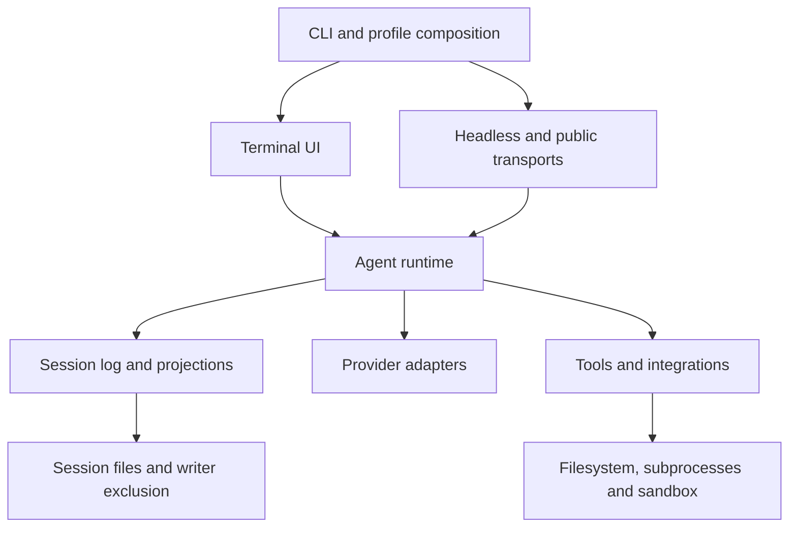

# Bake 0.4 Rust migration roadmap

## Summary

Port Bake's runtime and terminal application to Rust in a sequence of independently reviewable scopes. Keep 0.3.x on bug fixes while the native implementation develops; since [D34](scope-00/support.md#decision-register) (2026-10-14), the port lands on `develop`, the TypeScript agent there is frozen until the Rust release removes it, and 0.3 fixes and releases come from `release/0.3`. Since [D22](scope-00/support.md#decision-register) (2026-10-09), Pi's latest official source is the primary port source and Bake's TypeScript runtime a selective reference. Since [D32](scope-00/support.md#decision-register) (2026-10-10), 0.4 is a new binary with no migration from or interoperation with a TypeScript install, and it keeps three Bake contracts: the CLIProxyAPI provider route, Bake's sandbox, approvals, and permission presets, and the `~/.bake` home with its existing settings and credentials. It writes Pi's session format, and tools, schemas, results, and repair text follow Pi; since [D33](scope-00/support.md#decision-register) (2026-10-13), the system prompt is Bake's own, as the [system prompt design](system-prompt.md) describes. The [Pi-first scope plan](pi-first-plan.md) re-plans scopes 02 to 17 and governs where the scope specifications below still describe 0.3 parity. Later 0.4.x releases can improve performance and features after that baseline is established.

**Status: paused for continuation from one draft PR, 2026-10-17.** The [continuation checkpoint](continuation.md) records the saved work, known failures, and resume order. The opt-in [Rust workspace](../../../rust/README.md) runs real model sessions in the existing terminal frontend: `bun run dev:rust` opens it, while `bun run dev:rust:preview` keeps the sample preview. Streaming, tools, steering, cancellation, D24 approval prompts, model and account controls, and interactive session naming and switching work. Model, settings, and session controls use shared sheets; `/tree` navigates within a session, `/fork` creates a new one from an earlier message, `/resume` searches sessions as Pi's selector does, and `/compact` compacts the idle session. No scope is complete or in evidence review. Scope 11 has an unfinished background-job registry; scopes 13 and 17 have not started; scope 16 has a native preview packager, and scope 12 has native MCP client transports, an ordered tool-call veto for trusted compiled-in plugins, and an installed Wasm plugin Session veto whose combined qualification remains open; the open work in progress includes the kept-workflow mapping, Windows sandbox confinement, and ConPTY and Apple Silicon qualification. The analysis uses `origin/develop` at `ae5eb51ab61f2266b0fc2ff52f2f14b9f3a9a917`, whose product manifests say 0.3.8. A version in a manifest does not establish release publication. [Codebase analysis](analysis.md) records the source findings; [verification](verification.md) defines the evidence required to close each scope and distinguishes tests run during planning from future tests. Scope 00 tracks inventory, compatibility decisions, and reproducible baseline evidence under `scope-00/`.

## Table of Contents

- [Continuation checkpoint](continuation.md)
- [Release lines and change policy](#release-lines-and-change-policy)
- [Target architecture](#target-architecture)
- [Pi agent source reference](pi-reference.md)
- [Durable execution direction](durable-execution.md)
- [Pi-first scope plan](pi-first-plan.md)
- [Terminal direction](terminal.md)
- [System prompt design](system-prompt.md)
- [Native plugin design](native-plugins.md)
- [Linear development sequence](#linear-development-sequence)
- [Scope specifications](#scope-specifications)
- [PR and completion rules](#pr-and-completion-rules)
- [Release qualification](#release-qualification)
- [Dev Note](#dev-note)

## Release lines and change policy

Until 0.4.0 ships, Bake has 0.3.x maintenance and 0.4.x Rust development. From that release, only Rust Bake is shipped and maintained ([D10 and D13](scope-00/support.md#decision-register)). [D34](scope-00/support.md#decision-register) owns the branch policy; scope 16 must enforce the separate publication routes and 0.3 retirement.

| Line | Allowed work | Release condition |
|---|---|---|
| 0.3.x, until 0.4.0 ships | Reproducible correctness, security, provider-compatibility, installation, and platform fixes; tests and documentation needed for those fixes | Existing Bake gates and release procedure; no new features; no 0.3 publication after 0.4.0 ships |
| 0.4 development | Rust implementation and qualification on `develop`, where the TypeScript agent is frozen | Explicit development invocation in private test homes; the shipped 0.3 launcher still selects TypeScript |
| 0.4.0 | Rust-only product after every required scope closes; ends 0.3 maintenance | Retained-contract and platform evidence, native install/update/rollback qualification, retirement notice, and an explicit release request |
| 0.4.x after cutover | Bug fixes and measured improvements to the native implementation | Relevant regression tests and paired evals for model-visible changes |

Start Rust port work on fresh branches from up-to-date `origin/develop`, with PRs against `develop` or a stack on it, as [CONTRIBUTING](../../../CONTRIBUTING.md#the-rust-agent-and-the-frozen-typescript-agent) describes. The `rust/0.4.0` integration branch that carried the port until 2026-10-14 is merged into `develop` and retired. 0.3 fixes land on `release/0.3` and are released from it. During coexistence, keep Rust in a separate workspace and exclude it from 0.3 release archives and default startup. A 0.3 fix names the Rust scope that must adopt it when the behavior carries forward. Refresh the TypeScript comparison revision deliberately; record changes to the baseline instead of letting it drift silently.

**0.3 retires when 0.4.0 ships.** `release/0.3`, cut from v0.3.8 and protected by a ruleset, takes fixes through merge-commit pull requests until that release. Its current workflow accepts tags on that branch and publishes the single newest-version `latest.json`. Scope 16 must freeze that route at the final TypeScript release, give Rust a separate route, reject post-retirement 0.3 publication, and prevent either route from moving backward. These publication safeguards are not implemented by the support decision.

The TypeScript product stays frozen during qualification and is removed from `develop` under scope 17. D34 supersedes the proposed feature-bearing final 0.3 release; the port does not depend on that triage.

## Target architecture

The opt-in implementation uses a Cargo workspace under `rust/`. Bun owns the existing TypeScript workspace and its lockfile; Cargo owns Rust dependencies and `rust/Cargo.lock`. [AGENTS](../../../AGENTS.md#workspace) describes the separate toolchains. No root npm or pnpm lockfile is introduced.

Use a small number of crates organized by ownership, with modules inside them. The names below are proposed responsibilities, not a requirement to create every crate immediately. Provider streaming exists as `bake-ai`, which mirrors Pi's `ai` package (D22) and takes the `bake-llm` row's responsibility without its routes or authentication. The agent loop and stateful agent exist as `bake-agent`, which mirrors Pi's `agent` package and takes the loop and agent-state part of the `bake-runtime` row, without its policies, tools, prompts, or compaction. Pi's session store exists as the `session` module of `bake-coding-agent`, which mirrors Pi's `coding-agent` package and takes the `bake-session` row's responsibility, writer exclusion included.

| Proposed owner | Responsibility | Dependency restriction |
|---|---|---|
| `bake-protocol` | Session envelopes, model messages, tool schemas, public transport messages, error identities | No terminal, network, or filesystem effects |
| `bake-session` | Pi's session entry tree, context rebuild, session files, and writer exclusion | Core reduction remains pure; storage adapters own I/O |
| `bake-host` | Processes, filesystem, sandbox, settings, credentials, attachments, spill, terminal leases | Own every acquired resource and its asynchronous shutdown |
| `bake-llm` | Provider routes, authentication, request encoding, streams, retry classification | Depend on host interfaces; never own conversation state |
| `bake-runtime` | Agent state machine, inbox, policies, tools, prompts, compaction, goals, children | One authoritative session and serialized state owner per agent |
| `bake-integrations` | MCP, hooks, web tools, code mode, scheduling, the native plugin API | Use the same tools, permissions, and lifecycle as built-ins |
| `bake-tui` | Editor, layout, transcript presentation, terminal interaction | Read runtime projections; own presentation state only |
| `bake-cli` | Profile selection, headless and public transport entry points, updater, lifecycle | Compose services and select the frontend |
| `bake-conformance` | Test-only arms, such as the native eval fixture arm | Test-only; excluded from shipped archives |

Design the native core around ownership and small typed interfaces. Use Bake's TypeScript implementation and the upstream [DeepSeek Harness](https://github.com/deepseek-ai/deepseek-harness) and [pi](https://github.com/earendil-works/pi) repositories as references for behavior and implementation. Upstream remains read-only; Bake chooses its own Rust crate, module, and composition boundaries. Preserve behavior, released data, model-visible contracts, and the [support decisions](scope-00/support.md#decision-register). An agent task owns inbox transitions and durable event ordering. Bounded concurrent work returns results to that owner; only the owner commits them. Cancellation must stop new work and await owned work. Native extension points must preserve each shipped consumer's ordering, rewrite, delegation, and halt behavior. Qualify the composition mechanism against those consumers. Disposing a Rust object alone is not proof that asynchronous children have stopped.

0.4 reads and writes only Pi's session format, so it has no Bake Session import boundary ([D32](scope-00/support.md#decision-register)). Runtime interfaces follow their consumers and the proofs in each scope.

Candidate foundations are Cargo, Serde, Tokio, and a Ratatui/Crossterm terminal implementation. Cargo supports a shared workspace lockfile; Serde permits explicit wire representations; Tokio documents cancellation followed by waiting for task completion; Ratatui separates rendering from terminal backends. These are starting points for scope 01 and scope 14 experiments, not evidence of Bake compatibility. See the official [Cargo workspace reference](https://doc.rust-lang.org/cargo/reference/workspaces.html), [Serde representation reference](https://serde.rs/enum-representations.html), [Tokio shutdown guide](https://tokio.rs/tokio/topics/shutdown), and [Ratatui backend guide](https://ratatui.rs/concepts/backends/). Pin versions, supported Rust version, platform features, and licenses only after those experiments.

The [terminal direction](terminal.md) keeps the current transcript and composer layout recognizable, with cleaner presentation and clearer agent selection, status, and input focus. Ratatui with Crossterm is the starting stack. The composer uses a pure Bake-owned model following the [editor widget qualification](scope-00/editor-2026-10-07/README.md); the native frontend must pass the inline, Unicode, draft-preservation, and terminal-restoration cases before adoption.

Keep `run_code`'s JavaScript semantics through an explicitly confined embedded engine; moving the host to Rust does not authorize changing the model's programming language. 0.4 ships Rust only, with no bundled or selectable Node/TypeScript compatibility runtime ([D5](scope-00/support.md#decision-register), approved 2026-10-07). The TypeScript runtime stays runnable during development as the comparison oracle; it cannot count as native parity or serve behind a supposedly native profile. Custom JavaScript/Cordis profiles, user executable YAML, custom bundles, and npm profile plugins are excluded from 0.4.0; no profile compatibility loader or migration deliverable is required. Native entry paths must reject them before execution or file changes. 0.4.0 must ship a native plugin API; MCP servers and hook processes alone do not satisfy that requirement ([D6](scope-00/support.md#decision-register), decided 2026-10-07). The Cordis-specific tooling is retired, and Rust-native inspection and management capabilities designed with that API replace it ([D7](scope-00/support.md#decision-register)). CLIProxyAPI is the only 0.4.0 provider route ([D8](scope-00/support.md#decision-register)), and Bake Desktop integration, Electron message ports included, is deferred beyond 0.4.0 ([D9](scope-00/support.md#decision-register)). Scope 00 resolves the shipped support matrix; scopes 05, 12, and 13 prove it.

Port the Rust harness primarily from the latest official Pi agent source ([D22](scope-00/support.md#decision-register)), consulting Bake's TypeScript runtime selectively. [The pinned source review](pi-reference.md) maps Pi's agent loop, session services, provider boundary, and tool lifecycle to Bake scopes; refresh its pinned revision before porting each scope. The contracts [D32](scope-00/support.md#decision-register) retains (the CLIProxyAPI route, Bake's sandbox and permissions, and the `~/.bake` home) stay acceptance targets.

Structure the native runtime for durable execution, not only a durable transcript. The [durable execution direction](durable-execution.md) takes Pi Durable's task model as a reference: every model request, tool call, compaction, child agent, and job is an owned task whose unfinished state is derivable from the Session log; tools declare a replay class; one ownership tree governs cancellation, with an explicit foreground/background boundary; and clients attach to the owner's view. These rules stay inside Pi's session format. Its scope additions and crash-recovery matrix extend scopes 02–13; behavior that would change the model surface or format is listed there as post-0.4.0 candidates.

## Linear development sequence

Complete these scopes in order. Every scope depends on the previous scope's accepted evidence; a useful prototype may occur earlier, but it does not close a later scope. Split a large scope into the ordered PR slices specified below. Do not start another behavior port while the current scope has an unexplained failing required test.

The effort bands are relative: **M** is a bounded subsystem; **L** spans multiple packages; **XL** includes a platform or compatibility redesign. They are not calendar estimates. Re-estimate after scopes 00, 04, 07, and 14 using completed PR throughput and unresolved tests.

| Scope | Deliverable | Band | Exit evidence | State |
|---|---|---|---|---|
| 00 | Approved support decisions and frozen comparison baseline | L | Complete behavior inventory and repeatable TypeScript oracle | In progress |
| 01 | Rust workspace and native eval arm | M | Native test executable and a fake eval arm whose tampering controls fail | In progress: workspace, preview, and [native eval fixture adapter](../../../evals/README.md#native-fixture-adapter); [qualification ledger](ledger/README.md) records partial evidence; the synthetic comparison harness was deleted under [D32](scope-00/support.md#decision-register); the evaluator's [native bake-rs arm](../../../evals/README.md#native-bake-rs-arm) runs `bake-rs -p` live, checked keylessly, and its [first live record](../../../evals/agent-loop/versions/unreleased/2026-10-13-native-arm/REPORT.md) compares it with the TypeScript agent |
| 02 | Session types and pure projections | L | Pi's session entry tree and context rebuild ([D32](scope-00/support.md#decision-register)) | In progress: Pi's session model, ported from v1.1.0 and unchanged in v1.2.0; the [foundation status](verification.md#foundation-qualification-status) lists its recorded evidence and gaps |
| 03 | Persistence, locking, and queries | XL | Pi's session files, crash recovery, writer exclusion ([D32](scope-00/support.md#decision-register)) | In progress: Pi's session file reads and writes, writer exclusion, `fsync`-durable writes, and recoverable group appends; a process killed inside an append's write and the rest of the crash-recovery matrix remain ([foundation status](verification.md#foundation-qualification-status)) |
| 04 | Host processes and sandbox enforcement | XL | Real denied effects and process-tree quiescence on each OS | In progress: Pi output handling, mutation ordering, the bash tool's process-tree ownership, Pi's exec utility (no caller), the Linux and macOS sandbox backends, which confine file writes only, and the permission presets, approvals, and tool confinement, with interactive approval prompts in `bake-rs`; a caller for exec, the Windows backend, approval audit persistence, and Auto review remain open |
| 05 | Configuration, composition, credentials, and lifetime ownership | XL | Configuration precedence, scoped cleanup, login/storage parity | In progress: the read-only D25 import of a 0.3 home's settings and credentials, the settings read path, the model registry, auth storage, and locked, atomic settings and credential writes, and CLIProxyAPI login, refresh, and logout over them, which `bake-rs` runs as `/login`, `/logout`, `/refresh-models`, and a startup refresh, besides saving default models and `/settings` changes; a [live CLIProxyAPI smoke](ledger/scope-15/2026-10-15-interactive-controls.json) keeps a login across restart; and the session's owner of its work, with a background lifetime and awaited teardown (`WorkGate`, `AgentSession::spawn_background`). Shutdown now also awaits the process trees of the tool calls it cancels and each model request's provider task. Not qualified: the Windows and macOS process owners are checked only by cross-target Clippy here, MCP connections, jobs, and plugins' own long-running work are not yet under the gate (a plugin veto's decision write is), a normal exit's intentionally backgrounded processes are outside every drain, the bubblewrap payload's namespace teardown is not awaited, and `config_value` commands and sandbox probes are owned outside it |
| 06 | Provider-neutral streaming and failures | L | Stream assembly, cancellation, retry, and usage equivalence | In progress: Pi's provider-neutral streaming, cancellation, and retry, and Bake's runaway tool-argument whitespace guard |
| 07 | Provider protocols and authentication | XL | Wire fixtures and route/auth support matrix | In progress: the `anthropic-messages`, `openai-completions`, and `openai-responses` protocols and the CLIProxyAPI route; the model catalog, other providers, and OAuth remain |
| 08 | Tool dispatch and local coding tools | XL | Exact schemas/results, permission decisions, external file outcomes | In progress: Pi's file and bash tools and tool selection; `bash`, `write`, and `edit` run through the D24 permission engine and sandbox (scope 04 permissions note), and a response holding a `bash`, `edit`, or `write` call runs its calls in order ([D33](scope-00/support.md#decision-register)); interactive approvals answer escalations in `bake-rs`; approval audit events, replay classes, and durable checkpoints remain |
| 09 | Agent loop and headless vertical slice | XL | End-to-end edit/resume/cancel and paired agent-loop record | In progress: `bake-rs -p` runs Pi print mode with tools, `@file` text and image inputs, and session/model flags (`--continue`, `--session`, `--session-id`, `--fork`, `--session-dir`, `--name`, `--no-session`, `--models`, `--list-models`, `--api-key`) on the CLIProxyAPI route, and the evaluator's [native arm](../../../evals/README.md#native-bake-rs-arm) launches it; a [paired agent-loop record](../../../evals/agent-loop/versions/unreleased/2026-10-13-native-arm/REPORT.md) compares it with the TypeScript agent |
| 10 | Context, skills, attachments, and compaction | L | Prompt parity, reconstruction after replacement, long-session eval | In progress: Pi's compaction, branch summarization, and auto-retry, Bake's own system prompt with `bake-rs docs`, its user documentation, in place of Pi's ([D33](scope-00/support.md#decision-register)), `--system-prompt`, `--append-system-prompt`, and `--no-context-files`, `@file` text and image attachments with prompt and tool-result image resizing, Pi's prompt templates (`--prompt-template`, `--no-prompt-templates`), and Pi's skills from the universal `.agents` locations; the [long-session record](../../../evals/agent-loop/versions/unreleased/2026-10-16-long-session-sizing/REPORT.md) compacts and passes on all six models; a caller for branch summarization remains |
| 11 | Subagents, goals, background jobs, and schedules | XL | Durable orchestration and race/restart proofs | Planned |
| 12 | MCP, web, hooks, code mode, native plugin API, and extensions | XL | Protocol, permission, VM containment, plugin API design, native inspection and management capabilities, and extension compatibility | In progress: the trusted plugin tool-call veto, Wasm host boundary, configured Wasm vetoes in sessions with CLI install and enable, the `bake-mcp` client boundary with owned stdio server processes and Streamable HTTP, session-owned stdio servers admitted under D24 with their tools as one logged generation per listing (`bake-coding-agent::mcp`, `AgentSession::start_mcp`), and `bake-rs` starting the servers of an owner-controlled `$BAKE_HOME/mcp.json` for every session, with `--no-mcp`; Windows ACL checks of that file, HTTP servers and their egress admission, reconnect, OAuth, resources, web, hooks, code mode, and the remaining native plugin capabilities remain ([Dev Note](#dev-note)) |
| 13 | CLI profiles and public transports | L | Built entry points and transports tested against their retained consumers; Desktop deferred ([D9](scope-00/support.md#decision-register)) | Planned |
| 14 | Terminal engine, layout, and transcript | XL | Inline/fullscreen PTY, Unicode, scrollback, and restoration | In progress: fullscreen and inline fixture previews share the existing design, and `bake-rs` runs a real session through them; complete platform qualification remains |
| 15 | Interactive terminal workflows | XL | Complete shipped PTY scenario mapping and model-surface parity | In progress: an interactive session (prompts, steering, cancel, resume, and shutdown), D24 approval prompts, model, thinking, settings, and CLIProxyAPI account commands, and `/session`, `/name`, `/new`, `/resume`, `/tree`, and `/fork` in shared sheets following the TypeScript design; [tree/fork evidence](ledger/scope-15/2026-10-15-tree-fork.json) covers Linux and Intel macOS PTY, native Windows Cargo, and real-model branch/fork requests; `/resume` searches as Pi's session selector does, with [search qualification](ledger/scope-15/2026-10-15-session-search.json); `/compact` compacts the idle session; the other slash commands, ConPTY, Apple Silicon, and the shipped scenario mapping remain |
| 16 | Native distribution, update, and rollback | XL | Signed install/update/rollback on all five targets | Planned |
| 17 | Qualification, cutover, and retirement | L | Complete evidence ledger, evals, performance, migration rehearsal | Planned |

## Scope specifications

Each scope below specifies implementation, review order, and observable proof. Scopes 02 and 03 follow [D32](scope-00/support.md#decision-register). For scopes 04 to 17, the [Pi-first scope plan](pi-first-plan.md) governs where this text still assumes 0.3 parity; each scope's first PR rewrites its section. The [verification contract](verification.md#evidence-required-for-every-scope) applies to every scope, including a negative control, exact commands, platform results, and a rollback boundary. Existing test anchors are starting points for scenario extraction, not a claim that those files cover the whole scope.

### 00 — Support decisions and baseline

**Implement:** inventory every shipped profile, preset, command, tool, provider route/auth flow, configuration form, persisted artifact, and platform. Classify each as native parity, an explicit compatibility adapter, or a proposed support change needing approval. Resolve the 0.3 maintenance channel, old-home aliases, Cordis/plugin support, executable YAML, provider catalogs, Desktop launch integration, and native packaging. Preserve removed-product exclusions and Bake's own Desktop bundle.

**PR order:** support/release decision → inventory and scenario ownership → baseline capture and fixture extraction. Include a measured startup/RSS/shutdown baseline and terminal workloads. Select exact 0.3 release and `develop` commits; compare both where behavior differs.

**Proof:** the baseline rebuilds in a clean checkout; each supported behavior points to a test or an explicitly missing case; every existing test file and PTY scenario has a port/reuse/not-applicable disposition. Produce coverage gaps rather than marking untested cases passed. Resolve policy and compatibility decisions before scope 01 is accepted.

**Rollback:** documentation and test fixtures only; no user configuration or release routing changes until their own reviewed PRs land.

### 01 — Rust workspace and native eval arm

**Implement:** pinned Rust toolchain, locked dependencies, formatting/lint/test/build jobs, and native test executables. Adapt the eval runner's launch/composition interface now so later Rust scopes can satisfy the existing eval requirement; it currently assumes a Node CLI and Cordis overlays. The TypeScript/Rust fixture format and runners first built here were deleted under [D32](scope-00/support.md#decision-register).

**PR order:** workspace/static checks → native eval-arm support → platform smoke.

**Proof:** clean locked builds on Linux, macOS, and Windows. A fake native arm must pass fixture setup and be rejected when it tampers with an evaluator-owned check file. No live-model success is claimed yet.

**Rollback:** remove the opt-in workspace from invocation; 0.3 startup and packaging remain independently reproducible.

### 02 — Session model and projections

**Implement:** port Pi's session model from `coding-agent/src/core/session-manager.ts` at the pinned [Pi revision](pi-first-plan.md#pinned-pi-revision): the header and entry types (messages, thinking-level and model changes, usage, compaction, branch summaries, custom entries and messages, labels, session info, and context edits), the `id`/`parentId` entry tree, leaf selection and branching, tree traversal, Pi's own entry migrations, and `buildSessionContext`, which rebuilds the model context from the path to the leaf. Keep Pi's MIT notice and name the Pi file each module ports. The context rebuild is pure (`session::context` folds entries and opens no file); file access stays in Pi's `SessionManager`, as Pi structures it.

**PR order:** header and entry types with parsing → tree, branching, and labels → context rebuild and compaction placement. Record the Pi revision each PR adapts.

**Proof:** Pi's session-manager tests (`test/session-manager/`: build-context, labels, load-entries, migration, tree-traversal), ported with the code; a malformed or truncated entry is handled as Pi handles it. No Bake Session log is read or compared ([D32](scope-00/support.md#decision-register)).

**Rollback:** pure operations over fixture files only; no user data is read or written.

### 03 — Session storage and query

**Implement:** port the file side of Pi's session manager: session files under `<Bake home>/sessions`, create, append, rewrite, and resume of a session file, creating a branched session, finding the most recent session, and listing sessions with their info. Add writer exclusion for one session file, which Pi does not have, as a Bake design rule ([durable execution direction](durable-execution.md)); the mechanism is this scope's design. Session listing and query follow Pi.

**PR order:** file create/append/load → resume and branching into a new file → listing and recent-session lookup → writer exclusion.

**Proof:** Pi's file-operations, save-entry, and custom-session-id tests, ported; a writer killed mid-append leaves a file that resumes as Pi's loader reads it; a second Rust writer of the same session is refused while the first holds it, and takes over after the holder exits or is killed, on Linux, macOS, and Windows. There is no TypeScript writer in these proofs ([D32](scope-00/support.md#decision-register)).

**Rollback:** session files live only in private test homes until scope 09's headless slice writes them under a real home.

### 04 — Filesystem, processes, and sandbox

**Implement:** port Pi's `coding-agent/src/core/tools/bash.ts` with `utils/shell.ts` and `utils/child-process.ts` (done), `exec.ts` (done), `bash-executor.ts`, `tools/powershell.ts`, `tools/output-accumulator.ts`, `tools/truncate.ts`, `tools/file-mutation-queue.ts`, and their output-file helpers and tests. These own spawning, chunk-safe output, truncation, spill files, and mutation ordering. Add Bake's retained sandbox backends, approval prompts, permission presets, and process-tree ownership ([D24](scope-00/support.md#decision-register)): Linux bubblewrap/Landlock, macOS Seatbelt, and Windows AppContainer enforcement with explicit read and network grants ([D24](scope-00/support.md#windows-confinement)). The native Windows default still refuses confinement; the selected replacement is not implemented or qualified. Keep private atomic file creation, environment scrubbing, PTYs, process groups or Windows jobs, separate timeout and exit outcomes, and awaited cancellation. Preserve explicit reporting of partial enforcement and refusal when a required backend is unavailable.

**PR order:** output handling and private spill files → mutation ordering and process ownership → POSIX backends → Windows backend → hostile-operation and teardown integration. Existing native C helpers may remain while independently qualified replacements are evaluated.

**Proof:** port Pi's chunk-boundary and truncation regressions and compare output with Pi-generated fixtures. Attempt writes, renames, deletes, symlink/junction escapes, and descendant processes inside and outside permitted roots. Inspect the filesystem and surviving processes. Exercise timeout plus exit 0, ignored signals, cancellation during spawn, and repeated shutdown. Bake's retained restrictions use fixtures derived from the [sandbox scenarios](../../../packages/sandbox/sandbox-local/tests/) and [subprocess scenarios](../../../packages/subprocess/subprocess-local/tests/), with real OS enforcement on each platform. TypeScript Session compatibility is excluded by D32.

**Rollback:** native execution stays opt-in; no silent unsandboxed fallback. A missing platform backend blocks qualification for that platform.

### 05 — Composition, settings, credentials, and lifecycle

**Implement:** port, at the pinned [Pi revision](pi-first-plan.md#pinned-pi-revision), Pi's `coding-agent/src/core/{settings-manager,auth-storage,runtime-credentials,model-registry,resource-loader,agent-session-services}.ts` and the service lifetimes of `chord`: the settings and credentials a session reads and writes under the Bake home, their locked writes and reloads, and the services an agent session owns and tears down. Add the retained parts: the CLIProxyAPI route's login, refresh, and logout storage, the read-only [D25](scope-00/support.md#decision-register) import of a 0.3 home's route, key, and default model, and Bake's ownership-tree teardown ([durable execution direction](durable-execution.md), [defensive patterns](../../defensive-patterns.md)). Project settings need Pi's project trust and are not in this scope; Bake's TypeScript profiles, Cordis compositions, and their configuration are not retained ([D32](scope-00/support.md#decision-register)).

**PR order:** settings and credential reads and the D25 import (done) → durable settings and credential writes (done) → CLIProxyAPI login, refresh, and logout over those writes (done) → session services and scoped teardown.

**Proof:** Pi's settings-manager, auth-storage, and runtime-credentials tests, ported for what Bake has; independent processes writing with stale copies lose no update and keep unrelated settings, OAuth records, and unknown entries; malformed or unreadable files are left byte for byte; runtime keys are never written and no secret reaches `Debug` or an error; owner-only permissions; a killed writer leaves no lock that blocks a later write; a CLIProxyAPI login survives a restart; a 0.3 home's route is imported with `settings.yaml` and `.credentials.yaml` unchanged; scoped teardown leaves no surviving task.

**Rollback:** writes touch only Pi's `settings.json` and `auth.json` in the Bake home, never the 0.3 files. `bake-rs` writes them only for `/login`, `/logout`, `/refresh-models`, the startup refresh, a saved default model or thinking level, and `/settings` changes.

### 06 — Provider-neutral model runtime

**Implement:** immutable prepared calls, message/block assembly, live versus durable streams, finish/failure normalization, token accounting, route metadata, retry scheduling, deadlines, and cancellation. Keep the distinction between provider failures and defects in runtime consumers.

**PR order:** model types/assembly → streamed runtime → retry/default-resolution integration.

**Proof:** fragmented streams, split UTF-8, malformed arguments, premature EOF, abort before/after admission, empty responses, partial reasoning/text, max-token termination, and provider thrown-error versus terminal-error equivalence. Assert one terminal outcome, preserved partial output, correct cache-usage totals, and bounded buffers. Use [LLM tests](../../../packages/llm/llm/tests/) and [retry tests](../../../packages/llm/llm-retry/tests/).

**Rollback:** use the TypeScript adapter oracle; native streams have no live default consumer yet.

### 07 — Provider protocols and authentication

**Implement:** the 0.4.0 provider matrix, which is the CLIProxyAPI route only ([D8](scope-00/support.md#decision-register)): OpenAI Responses, Chat Completions, and Anthropic Messages as CLIProxyAPI selects them per model, the route's catalog discovery and backfill, its key resolution, and its login, refresh, and logout. Keep the existing implementations of the three protocols. `deepseek-official`, the other catalog transports, and direct API-key and OAuth logins are deferred to a later release; 0.4.0 neither qualifies nor claims them, and this scope states how it presents such a route without silently re-routing it. The [support register](scope-00/support.md#provider-routes-and-authentication) keeps the 0.3 inventory of those routes for that later release.

**PR order:** one protocol/route family per PR → replay/reasoning/cache fidelity → discovery/authentication → matrix qualification.

**Proof:** capture sanitized outgoing wire requests and replay provider streams through a local server. Compare schema ordering, model/effort/default resolution, reasoning signatures/replay state, image handling, cache controls, retry headers, stream idle timeouts, and the whitespace-runaway guard. Test proxies, TLS/custom endpoints, credential refresh races, failed refresh, and cancellation during login. Run key-gated smoke tests and paired evals for claimed live routes; mark unavailable credentials as missing evidence. For 0.4.0 the claimed live route is CLIProxyAPI over each of the three protocols. Anchors: [pi-ai tests](../../../packages/llm/llm-pi-ai/tests/) and the [CLIProxyAPI test](../../../apps/tui/packages/app/tests/cliproxyapi.test.ts).

**Rollback:** deferred routes stay visibly outside native support; they do not block the 0.4.0 cutover ([D8](scope-00/support.md#decision-register)).

### 08 — Tool pipeline and local tools

**Implement:** registry, exact schemas/descriptions, argument validation, timeout policy, approval/permission presets, progress, durable checkpoints, spill limits, and parallel-safe versus exclusive execution. Port read/write/edit, glob/search, bash/PowerShell, persistent shells, file-observation guards, and shell change reporting.

**PR order:** registry/policy → filesystem tools → shell/search tools → parallel scheduling. Preserve ordered result commits even when dispatch finishes out of order.

**Proof:** compare model-visible tool definitions, results, and errors, then independently read changed files. Cover stale edits, binary/large files, paths with spaces, Unicode, permission refusal, queued-call cancellation, exclusive barriers, reclassification, policy halt, and progress arriving during disposal. PTC's nested dispatch later must use this same pipeline. Anchors: [tool runtime](../../../packages/core/tools/tests/), [tool ordering](../../../packages/core/agent-loop/tests/tool-order.spec.ts), [filesystem tools](../../../packages/fs/tool-fs/tests/), and [shell packages](../../../packages/shell/).

**Rollback:** sandboxed private workspaces; no migration of the default tool registry until parity closes.

### 09 — Agent loop and first complete native task

**Implement:** create/resume/dispose, inbox claim/steering/removal, turn/step boundaries, prompt admission after route preparation, request headers, tool loops, retry/repair, cancellation, and a testable headless driver. Wire the native eval arm from scope 01 to the real binary.

**PR order:** lifecycle/inbox → request/stream/tool loop → headless edit/resume → paired evaluation. The first vertical slice must read a file, make a real edit, run its check, exit, and resume its exact session.

**Proof:** run shared transcripts through both runtimes; reconstruct every outgoing request from the committed log. Test cancellation at each admission/dispatch/commit boundary, follow-ups while stopping, max-token dropped calls, pending inbox preservation, tool outcome unknown after a crash, and no effects after dispose. Use [loop tests](../../../packages/core/agent-loop/tests/) and [built headless profile tests](../../../apps/cli/tests/profiles/). Record the standard task suite across both required model sets, three trials, against the clean PR base; additionally compare against the frozen 0.3 oracle.

**Rollback:** TypeScript remains the default entry point; native tasks use disposable homes or verified copies.

### 10 — Context and compaction

**Implement:** system prompt/persona composition, AGENTS discovery, file/session references, skills, runtime context, attachment admission and image variants, tool-result pruning, image offload, manual/automatic compaction, and context-pressure projection. Preserve each preset's defaults and prompt ordering.

**PR order:** instructions/skills/references → attachments → pruning/offload → compaction/checkpoint recovery.

**Proof:** exact first-request snapshots for every supported preset, nested instruction precedence, missing/changed referenced files, image budget failures, cancel during attachment admission, Unicode byte/character limits, and old messages remaining reconstructable after replacement. Test tool-call/result pairing across compaction, failed summary retries, restart after checkpoint, and a prompt queued behind manual compaction. Add the extended long-session eval to the mandatory standard record. Anchors: [context](../../../packages/context/), [attachment](../../../packages/attachment/), [compaction](../../../packages/compaction/), and [model-surface tests](../../../docs/testing.md#pin-the-model-surface).

**Rollback:** copied sessions only until replacements and resume pass; preserve original attachment bytes and generations.

### 11 — Durable orchestration

**Implement:** child creation/control/follow-up, preset and workspace inheritance, route selection/fallback, delegation limits, goals and automatic round continuation, background jobs, scheduled follow-ups, and their projections. Keep cancellation, turn completion, and per-message outcomes distinct.

**PR order:** background jobs → children and routing → goals → schedules/restart.

**Proof:** barriers place child completion before/during/after parent stopping; assert exactly one admitted completion notice, ordered results, no orphan workers, and correct continuation after restart. Cover invalid/slow router replies, denied child permissions, child scope cleanup, goal budgets, schedule clock jumps/time zones, duplicate wakeups, and persisted recurrence. Use [subagent tests](../../../packages/subagent/), [goal tests](../../../packages/goal/), [jobs tests](../../../packages/jobs/), and [schedule tests](../../../packages/schedule/schedule/tests/). Add delegation/background evals where affected, without replacing the standard suite.

**Rollback:** no shared scheduler or shared home between oracle and candidate runs; stop and drain all owned child work.

### 12 — Integrations and extension compatibility

**Implement:** MCP client/resources and reconnection, web search/fetch, hook protocols and external hook processes, code mode, the native plugin API that 0.4.0 requires ([D6](scope-00/support.md#decision-register)), and supported native extensions. Custom JavaScript/Cordis profile compatibility and migration are excluded ([D5](scope-00/support.md#decision-register)). The [native plugin design](native-plugins.md) proposes Rust traits for built-ins and WASI components for third-party plugins, with ordered contributions, explicit host capabilities, and a named consumer; the trusted veto dispatcher is implemented, while its other contributions, Wasm runtime, management, and containment still need implementation and qualification. The Cordis inspection and plugin-manager tools, the Cordis preset and host runner, and `bake plugin` are retired ([D7](scope-00/support.md#decision-register)); their JavaScript API catalog is never presented to the model. Design Rust-native inspection and management capabilities with the plugin API in their place; the [design](native-plugins.md#inspection-and-management) proposes optional inspection and management tools and CLI commands.

**Status (2026-10-17):** `bake-coding-agent::plugins` has the first slice of the proposed native plugin design: trusted Rust plugins compiled into `bake-rs` veto tool calls in order, with fail-closed failure and a persisted decision. No configuration enables one yet, so `bake-rs` runs with none. `plugins::wasm` hosts a third-party veto component in Bake's helper process under bounded protocol, memory, and lifetime controls, exercised by `bake-rs plugin check` and Linux process tests; no session registers one. The Wasm session adapter, configuration, the other contributions, plugin tools, management, and the D6 and D7 decisions remain open.

**PR order:** MCP → web/hooks → embedded code mode → native plugin API with its inspection and management capabilities → native consumer qualification and catalog generation. Use [Pi's latest MCP source and regression cases](pi-reference.md#native-mcp-direction) as the selected implementation reference, including OAuth cancellation and awaited shutdown; preserve Bake's tool names, resources, policy checks, and logged tool changes. Generate any plugin API catalog from the API's real interface. Regenerate model-facing catalogs from their owner and evaluate intentional prompt/schema changes.

**Proof:** local protocol servers check negotiation, tools/resources, invalid schemas, reconnect, cancellation, and shutdown. HTTP tests cover redirects, DNS rebinding/private destinations, pinned connections, payload limits, and proxy behavior. Code-mode tests cover nested approvals, memory/time exhaustion, infinite loops, denied ambient filesystem/network/process access, output limits, and VM termination. A named consumer exercises the native plugin API through the real native runtime, including version mismatch, denied permission, failure, shutdown, and every other lifetime transition the design defines. Run native fixture plugins through the chosen API, including load/unload/reload/failure, and exercise the inspection and management capabilities against them, including denied permission and failure; no 0.4 model surface carries a Cordis tool or catalog, and any model-visible capability has a paired eval record. Custom Cordis plugin migration is not an acceptance gate. Anchors: [MCP](../../../packages/mcp/), [web](../../../packages/web/), [hooks](../../../packages/hooks/), [code mode](../../../packages/ptc-runtime/), and [extensions](../../../packages/extensions/).

**Rollback:** native execution stays opt-in until the default switch. The TypeScript runtime remains a development oracle that 0.4 does not ship; work that still executes there does not close a native scope.

### 13 — CLI profiles and public transports

**Implement:** shipped flags, help, errors/exit statuses, exact resume, profile/preset selection, headless JSON output, `bake`/`dsh` aliases, environment compatibility, and session navigation/query APIs. Bake Desktop integration, its protocol, and its Electron launch are deferred beyond 0.4.0 ([D9](scope-00/support.md#decision-register)); the frozen TypeScript `desktop` bundle and its tests stay. Carry a native public or remote transport only for a consumer 0.4.0 retains and names, and test it against that consumer. Preserve local feedback, anonymous identity, telemetry opt-outs and explicit-feedback export rules, redacted diagnostics, and bounded exporter shutdown; replace V8-specific watchdog measurements with native measurements. Audit retained `api`, `client`, `host`, and `typert` consumers and either port the required protocol behavior or document an approved replacement before removal.

**PR order:** CLI/headless interface → profile compatibility → public transports for retained consumers.

**Proof:** fresh and retained profiles, rejection of excluded custom JavaScript/Cordis profiles, invalid args, missing model, busy session exit 75, redirected output, signal exit, self-check, and, for each retained transport consumer, its connect/message/cancel/shutdown path, permissions, and withdrawn approvals. A local collector must observe no export without the required consent/configuration; opt-outs and an unreachable collector must preserve prompt shutdown. Diagnostics must contain no credentials. Anchors: [CLI tests](../../../apps/cli/tests/).

**Rollback:** 0.4 installs beside 0.3 ([D32](scope-00/support.md#decision-register)), so a 0.3 install keeps its aliases and its `dsh --profile desktop` launch for the Desktop consumer.

### 14 — Terminal engine and rendering

**Implement:** terminal acquisition/release, inline scrollback, fullscreen viewport, input decoding, grapheme-aware editor, cell measurement, Markdown/tables/code, selection/copy, resize, and authoritative session/live-stream presentation. Follow the [crate selection and composer requirements](terminal.md#rust-crate-selection). Validate the renderer choice against inline behavior early; an alternate-screen demo is insufficient.

**PR order:** terminal lease/input → editor/Unicode → transcript/rendering → fullscreen/mouse/resize. Port observable layout obligations from [layout design](../../../apps/tui/DESIGN-LAYOUT.md); do not translate React components mechanically.

**Proof:** real PTYs and a terminal emulator verify cursor visibility, raw/cooked modes, bracketed paste, autowrap, alternate screen, mouse modes, scrollback preservation, and no duplicate settled blocks. Cover CJK, emoji, combining marks, Thai/Lao, narrow and short terminals, resizing during a stream, plain/no-color output, screen-reader mode, broken pipe, panic, and hangup. Reuse [UI tests](../../../apps/tui/packages/ui/tests/) and [PTY scenarios](../../../apps/tui/scripts/pty-smoke.ts). Add native Windows ConPTY coverage; existing POSIX skips are not Windows proof.

**Rollback:** explicit native frontend selection; every failure path restores terminal ownership before reporting failure.

### 15 — Interactive workflows

**Implement:** completion, history/drafts, slash commands, session picker/navigation, model/effort selection, provider login, permission/settings sheets, approvals/questions, skill invocation, attachments, goals, subagent inspection, update notices, and terminal setup/external-editor handoff. Apply the [agent-handling direction](terminal.md#agent-handling) and its explicit focus, destination, and draft-preservation acceptance cases.

**PR order:** session/composer flows → model/settings/login → human interactions → orchestration/attachments → remaining commands. Keep UI copy centralized and English; render runtime projections for activity, inbox, permissions, and context pressure.

**Proof:** map every existing PTY scenario to a native counterpart with the same externally visible success condition. Test canceled navigation retaining draft/session, canceled login exposing no secret, approval races, queued input and compaction, child inspection without changing parent input, and terminal restoration after an external editor. Pin each preset's model surface and replay persisted sessions. Source anchors: [TUI design](../../../apps/tui/DESIGN.md), [application tests](../../../apps/tui/packages/app/tests/), and the PTY driver. Intentional UI differences require their own reviewed acceptance criteria.

**Rollback:** keep the qualified TypeScript frontend runnable throughout native workflow development.

### 16 — Distribution and updates

**Implement:** native archives for `darwin-arm64`, `darwin-x64`, `linux-arm64`, `linux-x64`, and `win32-x64`; signed manifests; native installers and self-check; atomic native update/rollback; release retention; and separate publication routes. D32 requires a new install and excludes TypeScript-to-Rust upgrades ([D14](scope-00/support.md#decision-register)). Existing 0.3 updaters must remain on TypeScript.

**PR order:** native package layout and self-check → native installer and publication channels → native updater/rollback → five-target release rehearsal. Prove installation on a host without Node; Rust archives contain no Node runtime or TypeScript product code.

**Proof:** install from an empty home, update between native 0.4 releases, restart/resume, and roll back across each supported native data boundary. Corrupt signatures/hashes, truncated archives, disk-full, concurrent update, held Windows executables, interrupted pointer switching, and failed candidate self-check must preserve the working native install. A fresh install beside 0.3 must leave its executable, data, and command links working and preserve user-owned aliases. Test that publication cannot route a Rust archive to a 0.3 updater or move either channel backward. Use ephemeral signing keys in tests. Anchors: [distribution](../../../distribution/README.md), [release tooling](../../../scripts/release/), and the [support register](scope-00/support.md#packaging-update-and-rollback).

**Rollback:** a previously qualified native executable and usable native data remain available. Switching the binary alone does not prove data rollback; no rollback into TypeScript is required.

### 17 — Qualification and cutover

**Implement:** close the Pi-first support matrix, qualify retained Bake contracts, run native installation and recovery rehearsals and performance checks, remove the frozen TypeScript product, and update owning documentation. Check imports, manifests, YAML composition, generators, platform artifacts, and remaining consumers before removing product code. Preserve frozen session and eval evidence.

**PR order:** qualification report → final native packaging and TypeScript product removal → final archive rehearsal → release preparation. Retained-contract fixtures name their TypeScript sources; the shipped binary and archives depend only on the native implementation.

**Proof:** all scope evidence accepted, no unexplained skipped required tests, complete platform matrix, standard/extended model sets with three trials on the standard eval suite, supplemental long-session/delegation cases, and an independently verified native edit/test task. Repeat install, native update/rollback, and coexistence checks on final archives. Desktop integration and TypeScript session interoperability are excluded by D9 and D32. Demonstrate no unexplained regression in startup, first frame, memory, input response, long-session replay, or shutdown using the fixed method in [verification](verification.md#performance-and-soak).

**Rollback:** retain the last qualified native artifacts and their tested data recovery path. Existing 0.3 installs stay separate. A tag is pushed only on an explicit request to release; completion of this plan does not authorize publication.

## PR and completion rules

Every implementation PR names one scope, one observable result, its base commit, the affected support-matrix entries, and linked evidence. Include the corresponding regression test and owning documentation with the implementation. Model-visible changes require an eval record under the existing [eval policy](../../../evals/README.md); Rust work does not exempt schemas, errors, prompts, or adapter behavior.

Use these states: **Planned → In progress → Evidence review → Complete**. A blocked dependency is recorded with the missing decision/test owner. Do not mark a scope complete because code compiles, a unit suite passes, a demonstration works, or a deadline arrives. Required skips remain missing evidence until the required platform or credentials are available. Record actual commands and failures; preflight rerun warnings are not an unqualified clean run.

During coexistence, run the current Bake gates for affected TypeScript paths and the native gates for affected Rust paths. A terminal behavior change requires the built-profile PTY scenarios. Before a PR, run `bun run preflight` under the current repository policy; scope 01 must integrate native checks into the repository's documented verification path. Preserve hooks and frozen session/eval records.

## Release qualification

0.4.0 is ready for a release request only when all of the following have evidence:

- Every behavior the re-planned scopes require is native; the [D32](scope-00/support.md#decision-register) contracts hold (CLIProxyAPI against a live proxy, Bake's sandbox and permissions denying real effects, and the `~/.bake` home's existing route, key, and default model imported read-only); every 0.3 behavior not carried forward has a recorded retirement decision ([D22](scope-00/support.md#decision-register)).
- The native plugin API ships with documented versioning, permissions, and lifetimes, and a named consumer passes against final artifacts ([D6](scope-00/support.md#decision-register)). MCP servers and hook processes alone do not meet this requirement.
- Pi-format sessions resume after a killed writer, concurrent writers remain excluded, and installing 0.4 leaves a 0.3 install and its data working.
- All five release targets pass native artifact tests; each OS's sandbox and terminal behavior is tested on that OS.
- Every model-visible change has its required paired record. Regressions are fixed or their measured causes and acceptance are recorded in both the eval note and PR.
- Signing, fresh native install, native update/rollback, and preservation of existing installs and user-owned command links pass against final archives. The final TypeScript update route cannot serve Rust or accept post-retirement 0.3 publication. D9 excludes Desktop integration, and D32 excludes TypeScript upgrades and rollback.
- Performance thresholds fixed before candidate measurement pass; no unjoined tasks, orphan processes, leaked terminal modes, or unbounded growth remain in the qualified workloads.
- The 0.4.0 release notes announce the end of 0.3 maintenance and supported legacy aliases, explain the separate Rust installation, and link the retirement policy in D10 and D13.

## Dev Note

**Durable background job facts (2026-10-18, in progress).** The native job registry awaits a synced Pi custom start entry before invoking a producer and a synced terminal fact after resource cleanup before publishing its result. An admitted driver owns both writes through shutdown. Session delivery reservations become acknowledgements only after tool results or notices persist; an abandoned caller retains its delivery claim until the agent and persistence listeners are idle. Recovery reads execution facts across the file and observations on the selected branch, reserves IDs, and reports the recorded outcome or uncertainty. It never restarts a process or claims old output is available. The shipped recovery mapping covers background bash; generic registry kinds receive durable live acknowledgements but need an explicit recovery mapping before a new producer ships. Child-kill, failed-write, branch, and cancellation tests pass locally. The full preflight passes all 35 gates, including both PTY suites. The [paired native record](../../../evals/agent-loop/versions/unreleased/2026-10-18-job-journal/REPORT.md) retains 324 samples: five candidate models pass 27/27 tasks, and GPT passes 24/27 in both arms, with no flagged regression. The live runner uses `--no-session`; crash durability is established separately by the child-kill tests. The owner approved Gemini high in place of the missing medium route, leaving required medium coverage open. macOS failed SSH authentication before checks; native Windows qualification for this branch remains open.

The port is paused at the owner’s request. The [continuation checkpoint](continuation.md) supersedes older implementation-status notes where they describe MCP, Wasm consumers, Windows qualification, or the unfinished jobs foundation. The combined draft is not release evidence.

**Scope 11 background jobs (2026-10-18, in progress).** Re-checked Pi's latest official release: v1.3.0, `71023aec1546d6d677a65669c5665c0927ce0dd0`. Pi has no background jobs; its `sendCustomMessage` (`core/agent-session.ts`) is the delivery shape the notices adapt. The job tools port Bake's TypeScript `packages/jobs/tool-jobs/src/index.ts` and `packages/shell/tool-bash/src/background.ts`, and the print-mode wait ports `packages/bundle/headless/src/index.ts` `settleJobs`. Under [D35](scope-00/support.md#decision-register), `job_output`, `job_list`, and `job_kill` are default tools and `bash` takes `run_in_background`, which starts a `bash` job through the same `BashOperations`, so the D24 sandbox and approvals apply. A session owns one `JobRegistry` over its `WorkGate`, shared with the tools. A job that settles unreported becomes one `bake.job.notice` custom message, logged as a `custom_message` entry and sent to the model as a user message: inside a run at its next step or at the run's end, with the next prompt, or, when idle, by a turn it opens while the wake budget (3 turns without a prompt) lasts. `bake-rs -p` waits up to 10 minutes for jobs and their notice turns; the terminal opens a notice turn when idle and shows each notice as an information row. Jobs do not survive their process: a resumed session reserves every recorded job id and reports each job started on the current branch without a notice once, as lost, with the next prompt; nothing is re-run. Children, goals, and schedules, the paired eval for D35, and Windows qualification remain open.

**Windows AppContainer runner foundation (2026-10-17, in progress).** Pi's latest official release is v1.3.0, `71023aec1546d6d677a65669c5665c0927ce0dd0`; Pi has no sandbox to port. `bake-sandbox::backends::windows_appcontainer` implements the explicit read and network grants selected by [D24](scope-00/support.md#windows-confinement). It validates grant roots and gives each workspace read and write capabilities and each read root a read capability. Two native runs ruled out two identities. A standing profile per workspace (CI 39033317835) failed two of 36 enforcement cases: Windows rerouted `TEMP`, `TMP`, and `LOCALAPPDATA` to the profile's `AC` folder, as Microsoft documents, so runs on one workspace shared a writable `TEMP`. Package SIDs derived from unregistered names (CI 39035318623) started no program: `CreateProcessW` failed with `ERROR_FILE_NOT_FOUND` in 13 cases, while a shared-profile case showed a second process reading the first one's `TEMP` file. Each run now creates its own profile with a random name, owns it only when `CreateAppContainerProfile` succeeds (an existing name is refused and never deleted), uses the profile's `AC\Temp` as `TEMP` and `TMP` with no second temporary directory, and deletes the profile only after `bake-process`'s shared `windows_job::Job` settles on its account, or leaves the profile and grants and reports them when the account is pending or contradicted, a failed start or resume included. The enforcement fixture owns every runner it starts through `OwnedProcess` and deletes its tagged profiles only after each run's tree is shown ended. Under `read-only` it leaves the package SID only read and execute access on each profile object, replacing its explicit package ACEs (the profile's critical full-control ACE included) before process creation and again while the command is suspended; a package deny ACE was ignored by the AppContainer access check on Windows build 26300, and the command wrote its `TEMP` past it. A workspace or read root containing the profile is refused. A caller-minted `--profile-tag` can be inserted into the profile name so the enforcement tests attribute and reclaim only their own runs' profiles; Bake never sets it, and it never selects or adopts a profile. None of this has run natively yet: overlapping private `TEMP`, the read-only pass against the command's own attempts (an owner's implicit rights included), and deletion await the next Windows run. Profile registry storage is unmeasured, objects a broker creates after the resume are covered only by inheritance, and a killed runner leaves its profile. The command starts inside a kill-on-close Job. It reuses the restricted-token runner's helpers, whose retained source is `packages/sandbox/sandbox-windows-acl`. Loopback grants are refused because this implementation does not change persistent host exemptions. Only an explicit provider chain selects the runner, with partial enforcement; Windows still refuses confined commands by default. Linux tests and Windows GNU Clippy pass for this candidate. CI 39033317835 also measured both hard-link aliases widening access outside their roots and `git --version` failing to open `/dev/null`. Qualification remains open for capability grants, network and toolchain access, junctions and hard links, and the shared Job's settlement under this runner, which passed natively for the restricted-token runner (PR 245) but not yet here. Root checks do not inspect descendant ownership or reparse points. Standing ACEs remain after a run; a hard link can carry a grant outside its root. Session grant policy and standing-grant cleanup also remain. No model-visible behavior changed; enabling the backend or changing its denial text requires an eval.

The ConPTY driver includes the stdio MCP integration: the two home-configured MCP scenarios run on Linux and macOS and are explicitly skipped on Windows until owner/DACL trust is qualified. Every live scenario runs all registered cleanup after a failure; a platform gap cannot hide a cleanup failure.

**Windows ConPTY PTY driver (2026-10-17, in progress).** Re-checked Pi's latest official release: v1.3.0, `71023aec1546d6d677a65669c5665c0927ce0dd0`. Pi's only pseudo-terminal, `packages/env/daemon/src/pty.rs`, is Unix-only, so nothing is ported. `bun run test:rust:pty` now runs on Windows too: `scripts/rust-preview-pty.ts` drives either a POSIX PTY or the ConPTY host in `bake-process`'s `conpty` example, through `scripts/rust-pty-conpty.ts`. The host owns a pseudoconsole created without `PSEUDOCONSOLE_INHERIT_CURSOR` and a kill-on-close `windows_job::Job` its first client is born in; it services output, input, commands, and client events on their own threads, drains output through `ClosePseudoConsole`, reads exits from handles it holds, settles the job on its account, and joins every thread within a bound. A start that fails part way terminates the job, waits for the client's handle, closes the pseudoconsole only while its output thread drains it, joins every started thread, and settles the job before it returns; native fault controls fail the start before each step. The client reads `GetConsoleMode` inside the pseudoconsole before `bake-rs` starts, on request, and after it exits; input modes must be restored exactly, and an output mode left with VT processing set is a named gap, not restoration. The harness's own signal mapping is SIGINT to `CTRL_C_EVENT`, SIGTERM to `CTRL_BREAK_EVENT`, SIGHUP to `ClosePseudoConsole`, and SIGKILL to `TerminateProcess`. `bake_process::command_line::build_command_line` became public for it. A new control scenario on every platform kills the program and requires the mode reads to report the raw modes left. Named gaps, reported as `GAP` and never as passes: `bake-rs` has no Windows console control handler, so the SIGINT, SIGTERM, and hangup scenarios end in the default handler on Windows; VT modes conhost does not forward are not observed; Crossterm leaves `ENABLE_VIRTUAL_TERMINAL_PROCESSING` set. Linux passes all 51 scenarios; the Windows scenarios, and the job and pipe behavior they assert, have not yet run natively, and the parent Job owner's tests are not yet natively qualified on this base.

**Selected recovery and read scheduling (2026-10-18, under qualification).** Explicit recoverable runs journal original limits, model-call debits, durable message references, tool dispatch, and terminal outcomes in Pi custom entries. Print mode reports a run id before execution; `--resume-run <id> --session <path>` continues only a selected safe checkpoint with its remaining allowance. Unknown effects and interrupted timed runs are refused. `prompt_recoverable_with_job_wait` includes job-notice turns inside the same journal and control; the default wrapper waits up to ten minutes. The journal retains that policy and records when waiting begins. Resume never renews an interrupted wait without proof of completion, and a completed selected run returns its own answer without another provider call. `maxConcurrentReadTools` accepts 1–64 and bounds only trusted read batches; any unknown or mutating member makes its whole batch sequential. Blocking native read and directory listing work keeps the session owner until cleanup. Defaults remain unchanged, and live comparisons and native platform evidence are still required.

**Context masking experiment (2026-10-18, in progress).** `contextMasking: true` is a default-off experimental policy over the existing Pi projection. It preserves the most recent eight complete tool batches, latest successful reads per recorded path/range, errors, unknown tools, and explicitly edited observations; eligible older successful text observations become persisted placeholders without removing assistant calls or result identities. Owned context commits append the edits and publish the reconstructed context before dispatch. Tool-supplied provenance is stripped even while masking is off; a saved custom result cannot become eligible merely because a later session enables the policy. Recorded provenance remains trusted log metadata, not a signature. Foreground compaction remains the fallback, and disabling the experiment leaves existing edits intact. This is the conservative masking-plus-compaction arm proposed in the [durable execution Dev Note](durable-execution.md#dev-note), not an adoption of the paper's window or claimed savings. Paired evaluation uses identical budgets with background compaction disabled; crash, cancellation, retained-fact, repeated-read, and cache behavior require qualification.

**Run-control and document eval (2026-10-18).** The [three-arm native record](../../../evals/agent-loop/versions/unreleased/2026-10-18-run-control-documents/REPORT.md) retains all 432 standard-suite samples. Five models pass 24/24 in every arm; GPT passes 20/24 in the old and new default arms and 23/24 with documents enabled. No model calls the document tool, so its 9.8–20.9% same-binary total-token increase measures opt-in overhead and model variation, not document or verification benefit. The tool remains disabled by default. Gemini’s three candidate tool errors are unsuccessful Git inspection in non-repository fixtures, followed by successful task checks. Missing Gemini-medium coverage and incomplete usage on nine malformed GPT streams are retained. The later summary-cancellation correction passes full preflight but is not relabeled as the measured candidate.

**Print summary accounting (2026-10-18).** A print invocation cancels and awaits its final speculative summary before closing event listeners. The owned drain includes required debit writes and terminal attempt observation; a required-write failure prevents a successful exit. Held-provider tests cover text and JSON, and a real binary fixture retains a cancelled dispatch with unknown usage. The native evaluator smoke reconciles known usage. These checks repair accounting coverage; they do not establish a background-compaction cost or latency benefit.

**D36 background compaction (2026-10-18, in progress).** `backgroundCompaction: true` prepares one owned summary in the band from `contextWindow - 2 * reserveTokens` through the ordinary foreground threshold; windows no larger than twice the reserve have no speculative band. Every summary and retry uses the shared run control while preserving one foreground call. Turn boundaries validate the exact captured branch, summary inputs, retained boundary, model, thinking level, and compaction settings under the session write lock; descendant conversation growth is retained. A successful candidate appends an ordinary Pi compaction and installs its projection before releasing owned context exclusion. Navigation, manual compaction, foreground recovery, cancellation, and shutdown drain the provider; stale and cancelled debits are not refunded. JSON lifecycle events include per-attempt admission identity, available usage, dispatch state, and elapsed time, including partial split failures. An all-default usage value remains unknown because the provider message type has no usage-presence marker. Local snapshot, budget, cleanup, publication, and real child kill/reopen checks cover these rules. Positive-band paired evaluation and platform qualification remain open; no latency or cost improvement is assumed from the research.

**D36 prompt ownership (2026-10-18, in progress).** A session admits each prompt under an immutable execution identity and owns the whole preparation, agent, retry, queue, and settlement pipeline. Public callers only await completion. `abort` awaits the captured execution even when its original waiter is parked; dropped callers leave admitted orchestration running. Identity-checked settlement cannot clear a successor’s control, while a shared `RunControl` may cover multiple executions. The parked-caller regression failed before this change and passes with the owned driver. Paired qualification remains open. Job notices delivered at a prompt boundary, between active turns, or through `deliver_job_notices_with_control` share that execution’s control. Print mode retains its separate job-wait deadline and awaits abort plus delivery cleanup before returning. A negative control that resets the allowance fails the integrated notice regression.

**D36 task-document tool (2026-10-18, in progress).** `taskDocuments: true` enables a sequential list/get/revise tool and a mandatory pre-request context exposure boundary. Exact revision conflicts return recoverable tool errors; failed writes stop the run. Explicit CLI and configured tool restrictions continue to apply. Snapshot and exposure crash checkpoints reopen without duplicate revisions or model-visible copies. The SDK’s native-check evidence remains separate from model-authored document states. Live paired feature qualification and the broader recovery integration remain open.

**D36 execution foundations (2026-10-18, in progress).** `RunControl` carries one optional absolute deadline and logical model-call allowance through agent requests, session retries, continuations, and compaction summaries. `RunOutcome` distinguishes a finished turn, cancellation, budget exhaustion, and failure; JSON settlement includes that outcome, and print mode shares its control across prompts. Mandatory debit writes survive dropped or parked waiters and are drained before shutdown; an abandoned prompt retains its allowance and activity claim through agent cleanup and owned context commits. Required-write failures take precedence over cancellation. `task_documents` projects branch-local plan, todo, and goal snapshots with consecutive revisions and exact previous-entry checks; a completion claim is separate from verification. Each revision and its model-visible exposure use Pi custom entries, and `append_durable_group` can sync those entries before the first conversation. Interrupted groups retain the known synced prefix; exposure repair reads the actual projected context. Native-check evidence binds a host-owned ticket to the exact document revision, admitted command, persisted call/result, and unchanged declared file contents; freshness does not certify undeclared inputs or goal completion. Unix artifact reads use anchored directory handles, and Windows retains the permission layer’s junction-race limitation. The TUI uses the explicit settled outcome, including cancellation after a completed tool without an aborted assistant message. The foundational tests pass locally, while complete feature wiring, crash qualification, platform evidence, and paired feature evals remain open.

**Harness reliability (2026-10-18, in progress).** Re-checked Pi’s latest official release: v1.3.0, `71023aec1546d6d677a65669c5665c0927ce0dd0`. These are native fixes, with no new Pi behavior port: bash uses the retained Bake credential-name rule from `packages/subprocess/subprocess/src/index.ts`, shared with direct exec and MCP through `bake-process::environment`; explicit caller environment values still apply afterward. The agent reconciles tool declarations after `prepare_request` replaces its context. Ordinary observers contain panics independently; `Agent::subscribe_critical` preserves fail-closed execution participants, and `AgentSession` commits finished messages before publishing them. HTTP provider tasks stop when the last consumer leaves; body reads have a separate renewable idle timeout, and error-body reads retain their HTTP status and cap their bytes. Local regression tests cover each behavior, including a real child with synthetic credential names, replaced tool sets, committed file reads inside a callback, failed persistence, and all three provider protocols over owned loopback servers. The Linux full preflight passes 34 gates with the unchanged TypeScript runtime suite skipped, including both PTY suites. GNU Windows cross-target checks compile the full workspace and its blocked-output cancellation fixture; native Windows execution remains missing. The macOS attempt failed SSH authentication before executing checks. The [paired native record](../../../evals/agent-loop/versions/unreleased/2026-10-18-harness-reliability/REPORT.md) keeps 288 samples across six available models and three trials: five models pass all 24 candidate tasks, while GPT has seven candidate failures versus four base failures. DeepSeek Flash uses 7.6% more tokens; the record retains that regression and two additional tool errors on successful tasks. The owner approved Gemini high in place of the unavailable medium route; required medium coverage remains missing. The [durable-execution Dev Note](durable-execution.md#dev-note) records the controlled experiments. The owner separately adopted selected-run recovery, typed task documents, and background compaction as opt-in 0.4.0 scope under [D36](scope-00/support.md#decision-register); their implementation and qualification remain open.

**Scope 16 native archive license texts (2026-10-17, in progress).** Pi's latest official release is v1.3.0, `71023aec1546d6d677a65669c5665c0927ce0dd0`; it has no Cargo dependency-license tooling to port. `release:pack:rust` generates the native license bundle before building and archives this platform's text and the bundle inventory ([distribution](../../../distribution/README.md#native-preview-archive)). It checks recorded source hashes, platform and version, and Bake NOTICE contents before running the binary; unpacked files must match the generated bytes. A refused pack preserves an earlier archive. Native package tests compare with a separate generation, and CI installs the pinned cargo-about 0.9.2. macOS and Windows qualification, signing, manifests, installers, and publication remain open.

**Windows AppContainer selected (2026-10-17).** The owner chose AppContainer with explicit read and network grants for Windows confined modes, amending [D24](scope-00/support.md#decision-register). The [support contract](scope-00/support.md#windows-confinement) records the native mechanism observations and the remaining allowed/denied-operation, network, toolchain, and lifecycle proofs. This is a backend and access-policy choice, not an implementation or release qualification. The default Windows refusal remains until the new backend is qualified. No model-visible behavior changed in this documentation update.

**Scope 16 native license bundle (2026-10-17).** Re-checked Pi's latest official release: v1.3.0, `71023aec1546d6d677a65669c5665c0927ce0dd0`; Pi ships no Rust dependency-license tooling, so nothing is ported. `bun run gen-native-licenses` and `verify-native-licenses` ([distribution](../../../distribution/README.md#native-dependency-licenses)) write and check `.artifacts/native/licenses`: `inventory.json` and one `THIRD-PARTY-LICENSES.txt` per release platform, for the crates each target links (`cargo tree --target <triple> -e normal,no-proc-macro`) and, as build crates, their build-dependency and proc-macro subtrees from `cargo tree --target all`, with Bake's crate NOTICE files and third-party NOTICE, COPYRIGHT, and COPYING files verbatim. cargo-about 0.9.2 (`rust/about.toml`) owns license choice and acceptance. The script checks provenance only: the crate sets agree, each text is verbatim in a file of the crate's own package, and each hashed clarification keeps the declared license. Five clarifications cover granit-parser 1.3.0's inherited notices, ryu 1.0.23, sync_wrapper 1.0.2, windows-link 0.2.1, and windows-sys 0.61.2. At `213b4c57ac` the bundle covers 196 crates (darwin-arm64 189, darwin-x64 190, linux-arm64 190, linux-x64 191, win32-x64 187) and 126 texts. Nothing packs or publishes it; the preview packager must take `<platform>/THIRD-PARTY-LICENSES.txt` when packaging integration is added. A probe of the unmerged Wasmtime 49.0.3 host's lock fails as intended: `Apache-2.0 WITH LLVM-exception` is not accepted, fourteen Wasmtime and Cranelift crates ship no license file, and libm 0.2.16 and windows-targets and windows_x86_64_msvc 0.52.6 need clarifications. That branch must regenerate the bundle with reviewed `about.toml` changes, and the Wasmtime texts are the next integration step: reviewed official upstream license texts tied to the locked crate versions. A fixture showed that `cargo tree --target <triple>` evaluates build-host `cfg()` for the host it runs on, so the build list is the union over all build hosts rather than a per-runner graph; for the current lock it equals each Linux-printed per-target tree. Checking needs cargo-about installed, so no CI gate runs it yet.

**Scope 16 native preview archive and self-check (2026-10-17, in progress).** Re-checked Pi's latest official release: v1.3.0, `71023aec1546d6d677a65669c5665c0927ce0dd0`; scope 16 ports none of it, because Pi's package manager stays excluded ([D5](scope-00/support.md#decision-register)) and Bake's distribution is the retained contract. `bake-rs --self-check` prints a schema-1 JSON record of the Cargo version, the release platform, and the SHA-256 of each embedded documentation topic; it reads no home, credentials, or network, and refuses other platforms and extra arguments. `bun run release:pack:rust` packs the host's `bake-rs` with the pinned toolchain into `.artifacts/bake-rs-release/<version>/bake-rs-v<version>-<platform>.tar.gz`, holding only the binary, `LICENSE`, `THIRD_PARTY_NOTICES.md`, and the linked crates' NOTICE files; it checks the staged and the unpacked binary against the Cargo version, host platform, and documentation sources and renames the archive into place only after both pass, so a failure keeps the earlier archive ([distribution](../../../distribution/README.md#native-preview-archive)). The TypeScript `pack.ts`, `version.ts`, and `permissions.ts` (whose tar reader it reuses) are the reference; no TypeScript product source changed. The native preflight group's `test:rust:package` packs and runs the debug build without Node or Bun on PATH, in a broken home it leaves untouched. Still missing: the Cargo dependencies' license texts in the archive, signing and manifests, installers, separate publication routes and the frozen 0.3 route, update and rollback, and the five-platform rehearsal; Linux x64, Intel macOS, and Windows x64 checks have passed; Apple Silicon and Linux arm64 remain unqualified. This is not a release qualification.

**Sandbox runner Job settlement (2026-10-17).** Re-checked Pi's latest official release: v1.3.0, `71023aec1546d6d677a65669c5665c0927ce0dd0`. Pi still has no sandbox; its only Windows job, in `packages/env/daemon/src/sys/windows.rs`, is a libuv-style kill-on-close job that allows breakaway and settles nothing, so nothing here comes from Pi. The restricted-token runner (`bake-sandbox`'s `windows_acl`, ported from Bake's retained `packages/sandbox/sandbox-windows-acl`) drained its Job on the active count, as Bake's TypeScript `isJobEmpty` (`packages/subprocess/win32-process/src/process.ts`) did, and failed natively (PR244 run 39035543183 and PR241 run 39035520003, `descendants_end_with_the_command`): the drain returned with a grandchild still unsignalled. The job and its account now live in one place, `bake-process`'s public `windows_job::Job`, which the process owner and the runner share. It is created empty with its completion port associated, adopts no existing job, and lends its handle only by borrow. The runner pumps it while it waits for the command and, after the command's exit, terminates it again before every poll until the account settles, within the runner's 30 s budget; a budget overrun or a contradiction is a cleanup failure that keeps the private directory and grant. The account's limits are unchanged: a lost message, a failed association, a pid reused inside the job before it was opened, or a member the runner cannot open never settles. The runner tests now pin each descendant's handle while its parent still holds it and check it with no wait after the runner returns, in repeated cases across both modes, with an unconfined negative control and a runner owned by `OwnedProcess` killed mid-run. Against the old drain the orphan check fails only when the runner's cleanup is quicker than the member's rundown, so it detects that defect stochastically. The tests' own Job uses the same account for cleanup only. Native Windows execution belongs to CI; WRITE_RESTRICTED's deletion gap and the AppContainer runner are separate.

**Windows job settlement (2026-10-17).** The native probe (`bake-process/tests/windows_job_rundown.rs`, CI run 39034092791) showed that after `TerminateJobObject` a job's active count reaches 0, and the member leaves the job's process-id list, before the member's process handle is signalled. That happened in 50 of 50 runs, by up to 791 µs, and `OwnedProcess` reported `Gone` early in 20 of 20 cases. A killed Windows tree now settles on an account of the job instead. A completion port is associated with the job before the command exists. Every `JOB_OBJECT_MSG_NEW_PROCESS` names a member, which is held by handle (confirmed with `IsProcessInJob`, and identified by pid and creation time) until it is signalled. The number of distinct members must equal the job's `TotalProcesses`, read before and after every member is seen ended, with no active process left. Because message delivery is documented as not guaranteed, a lost message, an unopenable member, or a count that does not match never settles: the coding tools keep waiting and MCP reports the shutdown incomplete. For a reported pid that no longer opens or now names a process outside the job, completed exit is inferred from [Microsoft’s process-id lifetime explanation](https://devblogs.microsoft.com/oldnewthing/20110107-00/?p=11803/): the id remains associated with the process object, which retains itself while running, and an exited object remains openable while it exists. Other open or query errors remain unknown. The native probe saw each id stay openable until its handle was signalled. Normal-exit detach removes the port association. The account is kept for the tree's whole life, not only at a kill. An owned pump task, started in the same poll as the owner, takes the port's messages in bounded steps, yielding between them and backing off from 1 ms to 50 ms when idle, and closes the handles of members seen signalled. It holds only a weak reference to the tree, never across an await, so it cannot keep the job alive. A settled owner stops and awaits it before releasing its claim; a drop without a claim aborts it. The pump keeps the kernel queue to what arrives between steps only while it gets CPU at least as fast as the tree starts processes, and the settle still drains whatever it missed. The account keeps one record per distinct pid, up to 2^20, beyond which it refuses and never settles. Unix is unchanged.

**MCP CLI consumer (2026-10-18, in progress).** Re-checked Pi's latest official release: v1.3.0, `71023aec1546d6d677a65669c5665c0927ce0dd0`, still the newest tag. `bake-rs` now consumes the session adapter: every session `cli::build_session` builds, the first and each `SessionFactory` replacement, reads `$BAKE_HOME/mcp.json` with its resources (Pi's `loadMcpConfig` global file, `src/extensions/mcp/config.ts`; no project file) and starts its servers last, through `AgentSession::start_mcp`, under the session's standing permission and sandbox provider; `--no-mcp` is Pi's flag (`src/cli/args.ts`). A server is admitted once, at its start, and keeps that mode; there is no per-call approval and no readmission when the permission changes. Because an entry's `env` can pass a scrubbed credential, the file must be the owner's (`mcp::home`): on Unix the home is resolved once and opened from `/` one component at a time without following links, and the rules read the opened handles: owner the user or root, no group or other write on the file or any directory above it (sticky directories excepted, as OpenSSH's `StrictModes` allows), and, below the user's home directory, no directory the session's working directory or a git work tree. ACLs are part of the rule: on Linux the POSIX ACL mask is the group bits the mode rule reads; on macOS each opened object's extended ACL is read through its descriptor and a foreign `allow` entry granting any change refuses the file, `deny` entries being kept; macOS ACL evidence needs the real-Mac run. Other Unix systems and Windows, whose ACLs are not checked yet, refuse an existing file unread until that check is implemented and qualified. Problems are startup warnings, escaped for the terminal, and print mode reports servers that did not start after the first prompt's startup wait (Pi's `reportProblems`, which Pi's print mode leaves silent). `url` servers are dropped with a warning until HTTP has egress admission. `--tools`, `--exclude-tools`, and `--no-tools` restrict MCP tools at every declaration, later listings included, as Pi's `_isAllowedTool` and `_isActivatable` do without tool search; `--no-tools` alone starts no server. Print mode's `SIGINT` (Ctrl+C), `SIGTERM`, and `SIGHUP` handlers install before setup and are honoured while setup waits for piped input or the servers' startup and while prompts run, each shutting the session and its servers down, awaited. A replacement session (`/new`, `/resume`, `/fork`) is still built before the running one is torn down, so a failed build keeps it, but it starts its servers only after that teardown (`Replacement::start_servers`), Pi's teardown-then-create order. Interactive mode shows config warnings before the terminal starts but not a server's own failure. A live PTY scenario covers the terminal's replacement order on Linux: an owner-home stdio server holding a descendant, `/new`, `/resume`, and `/fork` each starting the next server only after the previous server, its descendant, and, with an installed plugin that lists the server's tool, the previous session's plugin helper are gone (checked by the new server as it starts), cancelled sheets starting nothing, `--exclude-tools` on every request, `-nt` starting no server, and nothing left after a double Ctrl+C quit. The scenario is written to run on macOS but has not been run there; Windows ConPTY is not implemented. The macOS ACL reading fails closed on any `acl_*` result Apple's Libc does not document as success or end. The change is model-visible whenever `mcp.json` configures servers (their tools are declared), so it needs a paired eval with an MCP fixture scenario; with no `mcp.json`, requests are unchanged.

**MCP servers a session owns (2026-10-17).** Re-checked Pi's latest official release: v1.3.0, `71023aec1546d6d677a65669c5665c0927ce0dd0`, still the newest tag. `bake-coding-agent::mcp` adapts Pi's MCP integration, `coding-agent/src/extensions/mcp/{config,runtime,tools,index}.ts` and `src/core/mcp-servers.ts`, with Pi's MIT notice and the cases of `test/mcp-extension.test.ts` and `test/suite/agent-session-mcp.test.ts` it covers; the public tool names keep Bake's retained `publicToolName` (`packages/mcp/mcp-client/src/tools.ts`, a 12-hex SHA-256 suffix whenever a name is changed, recorded by `tests/fixtures/mcp/public-names.mjs`), and a listing is accepted whole or not at all, as Bake's `syncTools` does. `AgentSession::start_mcp` starts each enabled server as a task of the session's `WorkGate`: D24 admission comes before anything runs (a `url` server is refused, since Streamable HTTP has no egress admission yet; a stdio server is wrapped by the session's sandbox provider for its standing mode, or refused with `SandboxUnavailable` when no backend enforces it, so the Windows default refuses confined modes), with Bake's scrubbed environment and the entry's `env` (variable templates, never `!command`) over it. From the spawn on, the task holds the `StdioProcess` and the `Connecting`, then the client, together; whatever ends serving (session shutdown, failed initialization or discovery, a closed connection), it withdraws the server's tools, shuts the client down, and calls `StdioProcess::shutdown` until it returns `Ok`, retrying `ShutdownIncomplete`, before its permit is released, so `AgentSession::shutdown` returns only once every server and its tree are gone, a cancelled `initialize` included. No lock is held across a protocol await. Each prompt declares the tools published when it starts (the first waits up to 10 s for servers still connecting, as Pi's `waitForDirectServers` does, and Esc ends that wait); the agent logs added and removed tools in a system message of the session file, so a resumed session declares no stale tool. A run keeps its tools, and each tool keeps the client of its generation; `notifications/tools/list_changed` re-lists, and a listing with a repeated name, a non-object input schema, a name taken by another server or a built-in tool, or a definition over the bounds (512 tools, 64 KiB each) keeps the earlier generation with the error in its status. Esc ends one call's request (`notifications/cancelled`), not its server; a crashed server's tools are withdrawn rather than reconnected. Lifetime and permission boundaries follow the retained TypeScript: its sandbox knob is resolved per call by the shell, code mode, and file tools (`packages/shell/tool-bash/src/index.ts` `resolveSandboxPolicy`, `packages/core/tools/src/ptc.ts`), MCP servers are spawned outside it (`packages/mcp/mcp-client/src/transport.ts`), and no terminal permission package gates `mcp__` calls in `tools/pre-execute` (`packages/core/tools/src/index.ts`). So a server is admitted once, at its start, under the mode then in force (the native D24 admission this slice adds), keeps that confinement until it ends, and is not restarted when `StandingPermissions::set` later changes the mode; MCP calls have no approval step, and MCP tools take no `sandbox_permissions`. The Bake Desktop tier that denies or asks for other tools (`packages/bundle/desktop/src/permission.ts` `classifyTool`) belongs to the deferred Desktop integration ([D9](scope-00/support.md#decision-register)). An entry's `env` goes over Bake's scrubbed environment and may name a scrubbed variable, as an explicit TypeScript `env` overrides `scrubbedParentEnv`, so only an owner-controlled file may be loaded; a sandbox runner's variables go over the entry's. Results follow Pi's `convertMcpResult`: text and images, embedded text resources, notes for links, audio, and other blocks, binary resources saved to private `bake-mcp` files, and text over 20 KB cut in the middle with the whole saved beside it; `isError` is an error result. `start_mcp` checks the public options before anything starts: a startup wait, request timeout, or shutdown wait whose deadline the clock cannot represent is refused, with `bake-mcp`'s `StdioOptions::validate` for the server's own. `mcp::config` reads Pi's `mcpServers` shape from one file the caller names, with Pi's messages; only the `direct` and `hidden` exposures exist (no code mode or tool search), and there is no project file. `tests/mcp_session.rs` runs a real `AgentSession` over the faux model against this test binary as a stdio server: admission allowed, wrapped, and denied before any process; calls, errors, and the scrubbed and templated environment; the logged declaration; Esc; shutdown during a stalled `initialize` of a server that ignores its input's end and `SIGTERM`; failed discovery; a refresh during an in-flight call; a crash; a resume; a running server that keeps its start-time admission after a permission change; an entry `env` that cannot forge the runner's variables; and, on Linux with bubblewrap, a write outside the workspace denied; those identities check, immediately after a shutdown, that no server or descendant outlives it, and every case is cleaned up and awaited within bounds on failure or timeout. Every server and descendant a check names must be observed while it cannot have been reused, by a Linux pidfd, a Windows process handle, or a macOS pid with its start time (`proc_pidinfo` with zombies included; macOS cannot check and kill atomically, so a cleanup kill of an exited process whose pid was just reused is this fixture's macOS limitation), so no check passes without a process on any platform; a case observes the observer itself. Removing the process shutdown or the sandbox wrap makes their cases fail; removing the tool's own abort branch does not, since the agent loop drops an aborted call, whose dropped request is what sends the cancellation. Nothing loads `mcp.json` yet: the next consumer is `cli::build_session`, reading `$BAKE_HOME/mcp.json` with Pi's `--no-mcp`, reporting refused entries and failed servers, and documenting it in `bake-rs docs`; it is the first model-visible change and needs the paired eval. Not implemented: HTTP servers, reconnect, OAuth, resources and their tools, server instructions and Pi's `mcp_servers` prompt section, `--tools` filtering of MCP tools, progress, and the `/mcp` command. Because nothing loads `mcp.json` yet, no model request carries MCP tools from this slice, and it records no eval; that is not a waiver for the consumer, which needs the model-visible evidence the eval policy requires. Native Windows and macOS runs belong to platform qualification.

**Shared process owner (2026-10-17).** Re-checked Pi's latest official release: v1.3.0, `71023aec1546d6d677a65669c5665c0927ce0dd0`; its `coding-agent/src/utils/shell.ts` and `child-process.ts` are what the owner adapts, and Pi's MIT notice moves with them. The new `bake-process` crate is the one owner of a spawned child and its tree, used by both `bake-coding-agent`'s tools and `bake-mcp`'s stdio servers and depending on neither: `bake-coding-agent`'s `child_process.rs` (owner and Unix leader), `child_process/windows.rs` (the child born in its job, connected overlapped pipes), and `tools/bash/tree.rs` (pinned group membership, Linux `/proc` bytes and pid 1 orphan reaping, macOS `proc_listpids`, the Windows job's active count, and the tracked-tree registry) moved there with their unit tests, and `bake-mcp`'s own `stdio/server.rs` is deleted. Admission stays with each consumer: the caller takes its owner's `Claim` (the coding tools' `WorkGate` permit) before the spawn, and the claim moves with a dropped process to the task that settles it. Exit policy is the caller's: the tools detach a command that exits by itself, so its background descendants keep running as in Pi, and kill after an abort, a timeout, or a stop; an MCP shutdown always kills, after the server exits as well, and closes the old Unix gap: the group is now awaited until no member is observed before the leader is reaped, so `TreeEnd::Killed`, a kill request, is replaced by `TreeEnd::Empty` on every platform. The owner settles in place and is cancel safe (`finish`), so MCP's bounded `kill_wait` still returns `ShutdownIncomplete` (now with `exited` in place of `reaped`, since an exited server stays unreaped while its tree is awaited) with everything owned for the next call. The owner also probes the leader's identity before every signal and drop, which MCP did and the tools did not. `spawn_stdio` becomes async, because Windows connects its pipes before creating the process; on Windows MCP servers now resolve a bare program on their own `PATH` only and refuse batch files, as the tools did, and on Unix they lead a new session (`setsid`) rather than only a process group. The Windows command-line quoting is `bake-sandbox`'s rule, copied with its cases so the owner needs no sandbox dependency (MCP's own copy is gone). The MCP fixture now checks each pipe-holding grandchild gone, not even a zombie, the moment a shutdown reports `Empty`, and, on Linux, a killed grandchild kept a zombie member by a subreaper test process holds every shutdown incomplete with the exited server unreaped until the test reaps it. No model-visible surface, configuration, or tool changes; no eval applies.

**Rust-only support at release (2026-10-17, [D10 and D13](scope-00/support.md#decision-register)).** The owner ended 0.3 bug/security maintenance at the 0.4.0 release and chose to keep only Rust Bake. Supported legacy `dsh`, profile, and package aliases retire with 0.3. Native environment fallbacks and existing installs and user-owned command links remain preserved. Scope 16 still needs a frozen final TypeScript route, a separate native route, and enforcement against post-retirement 0.3 publication; scope 17 owns TypeScript product removal and the release notice. These decisions do not qualify an artifact or authorize a release.

**Support bounds for 0.4.0 (2026-10-17, [D7](scope-00/support.md#decision-register), [D8](scope-00/support.md#decision-register), [D9](scope-00/support.md#decision-register)).** The owner decided three scope-00 rows. CLIProxyAPI is the only 0.4.0 provider route; its three wire protocols stay required and their implementations stay, and direct providers are deferred. Bake Desktop integration is deferred beyond 0.4.0, the frozen TypeScript `desktop` bundle and its tests stay, and scope 13's transports follow retained consumers. The Cordis-specific tooling is retired, and scope 12 designs Rust-native inspection and management capabilities with the plugin API; no tool name or plugin execution architecture is accepted. The [support register](scope-00/support.md#acceptance-matrix) and scopes 07, 12, and 13 carry the bounds and their required evidence. No code changed, and no scope closes.

**Scope 03 recoverable group appends (2026-10-17).** Re-checked Pi's latest official release: v1.3.0, `71023aec1546d6d677a65669c5665c0927ce0dd0`, whose `session-manager.ts` is unchanged since v1.1.0; Pi has no group append, so none is ported. `SessionManager::append_group` implements [durable execution rule 4](durable-execution.md#4-commit-related-entries-as-a-recoverable-group) over Pi's unchanged lines (D32): typed `GroupEntry` values (model change, thinking-level change, context edit) are checked before any write, chained, and written in order under the caller's hold of the manager, each line synced before the next. A group is not atomic. A failure before its first line keeps nothing; a failure at a line returns `SessionError::GroupWrite` (`GroupWriteError`, `FailedLine`) with the entries written and synced, which the manager keeps, and no later line is written. Single appends keep Pi's failed-entry-in-memory behavior. Three consumers use it, in `AgentSession`'s write boundary, which records the gap so a failed group is never retried: `set_model` writes the model and its level as one group, so no message lands between them, and applies the model only once its line is known synced; Pi's `_omitRecoveryAttempt` (`agent-session.ts`) writes its context edits as one group, the attempt's last rather than first, so no crash prefix leaves a tool result whose call is omitted, and records a failed omission's gap, which it did not before; and `AgentSession::create` writes a session's initial model and level as one group. A fully written omission projects to the same request as Pi's order; a failed or crashed omission can leave a different, provider-valid prefix, so paired evaluation remains pending. A failed group keeps only its known synced prefix: an immediate reopen may read one entry more, a line written without a sync or torn after its whole JSON, so no equality with a reopen is claimed after such a failure. A failed recovery omission publishes that prefix to the transcript and ends the run before another provider request. Tests read real file bytes at every byte prefix of both consumer groups, inject a refused, torn, and unsynced line at each line (the seam panics if its own write or sync fails), and kill a child writer process after each synced line of an omission and after part of a line it wrote and synced, checking that the parent's kill ended it; a kill inside a `write` system call and real `ENOSPC` or `EIO` are still open.

**Unanswered tool calls (2026-10-17, scope 02).** `session::unanswered::build_unanswered_tool_calls` lists the entry id, call id, and tool name of calls the next request closes with Pi's synthetic `No result provided` result. Its source is Pi v1.3.0 (`71023aec1546d6d677a65669c5665c0927ce0dd0`), `packages/ai/src/api/transform-messages.ts`; the orphaned-call rule is unchanged since v1.1.0. It reads projected context, including compaction and context edits, and excludes messages the request drops. It does not reconstruct full path history or establish whether a tool's effects happened. Those recovery questions, open children, and the pending inbox remain open under [durable execution](durable-execution.md). The [initial qualification record](ledger/scope-02/2026-10-17-unanswered-tool-calls.json) preserves its Linux and Intel macOS evidence and rule-defect controls. The [native-host follow-up](ledger/scope-02/2026-10-17-unanswered-native-hosts.json) records all 13 projection tests passing on Linux, Intel macOS, and Windows at a rebased candidate with unchanged function and fixture bytes; arm64 and the remaining session integration stay open. Tests check hand-derived answers and agreement with `bake-ai::transform_messages`, at every byte truncation for the last leaf and every line boundary for all leaves. The repair test includes unanswered calls. Ignoring aborted messages' exclusion or failing to close calls at a user message makes the tests fail. No model-visible behavior changes.

**Native plugin tool-call veto (2026-10-17, [D6](scope-00/support.md#decision-register), [D24](scope-00/support.md#decision-register)).** Re-checked Pi's latest official release: v1.3.0, `71023aec1546d6d677a65669c5665c0927ce0dd0`. `bake-coding-agent::plugins` adapts `ExtensionRunner.emitToolCall` (`src/core/extensions/runner.ts`), `ToolCallEventResult` (`extensions/types.ts`), and `AgentSession._beforeToolCall` (`agent-session.ts`), and ports `examples/extensions/protected-paths.ts` as `ProtectedPaths`, under Pi's MIT notice. This is the trait-and-veto slice of the proposed native plugin design, which is under review in its own pull request, for trusted code compiled into `bake-rs`. A `Plugin` declares a validated `PluginManifest` (id, version, and the tools it may veto). `AgentSessionOptions::plugins` takes a `PluginRegistry`, and the session installs a `before_tool_call` hook only when it holds a plugin. The hook asks the plugins that list the call's tool, in configured order and then by id, over read-only arguments; the first block wins. Pi's handlers may rewrite arguments; here a plugin cannot, so the persisted assistant `toolCall` is what runs, and a `continue` only lets the call reach the tool and its D24 checks. An error, panic, missed deadline, or reason over 16 KiB fails the plugin; it blocks that call and every later call to its listed tools without being asked again, for the life of the `AgentSession`. That failure is in memory only, so a reopened session asks the plugin again; restoring it is open and must be settled before configuration registers a plugin. There is no disable, restart, or reload. Cancelling a call fails no plugin: for trusted in-process code, dropping the future is a clean stop, so an Esc during a check records nothing and the next call asks the plugin again. A failure recorded before the cancellation stays, so that plugin still blocks the next call. Each block is written as a Pi `custom` entry, `bake.plugin.decision` (plugin, version, call id, tool, decision, the denial text, and any failure), through the session's write boundary before the agent emits the denial `toolResult`. A failed write records the gap and aborts the run before the tool or another model request. No lock is held while a plugin runs. The plugin's future runs inside the agent's run, so shutdown and Esc drop it, and the decision write holds a `WorkGate` permit that shutdown waits for. The call's signal is checked again when the decision write is admitted under the session lock; cancelled by then, nothing is written. Cancelled after admission, the owned entry stays and the call's result is still the loop's `Operation aborted`, the tested case in which a decision has no matching denial; a crash or shutdown before the result is written, or a failed result write, leaves the same trace, so a missing denial does not name its cause. No write is admitted after shutdown returns. `ProtectedPaths` keeps Pi's case-sensitive substring match, so case-folded names and `\` separators are not caught. Tests run real D24 `write` and `edit` calls through `AgentSession` over the faux provider and read the session file from disk; negative controls, each a small production mutation, fail their tests. `bake-rs` passes an empty registry, so behavior, requests, and the session file are unchanged and no eval record is needed. Open: plugin configuration, Wasm components, the other contributions, plugin tools, management, and A19 and A20 qualification.

**MCP stdio ownership review fixes (2026-10-17).** Pi's latest official release is still v1.3.0, `71023aec1546d6d677a65669c5665c0927ce0dd0`. Main's review of the stdio slice found four ownership defects, each now reproduced by a test that failed on the defect and fixed. `StdioProcess::shutdown` took the standard error reader's handle before awaiting it, so a dropped shutdown detached the reader; the handle now stays in the owner until the task ends. Unix shutdown reaped the server and then signalled its group, and drop signalled it again, although a reaped leader's pid and group id can be reused; the owner now observes exit with `waitid(WNOWAIT)` woken by `SIGCHLD`, kills the group while the leader is still an unreaped zombie, then reaps, and sends no group signal once the leader is reaped or was reaped by someone else (`TreeEnd::NotSignalled`). A shutdown that gave up after the kill memoized a report with no status; it now returns `ShutdownIncomplete` with the process, tree, and reader still owned, and the next call resumes. Windows created the server suspended and assigned the Job afterwards; it now creates the server inside a kill-on-close Job (`PROC_THREAD_ATTRIBUTE_JOB_LIST`) with only its pipe ends inherited (`PROC_THREAD_ATTRIBUTE_HANDLE_LIST`), on stable Rust 1.99 through `windows-sys`. A follow-up review found the Windows pipes used Tokio's blocking-pool `ChildStdio` and that the reap did not wait for the Job: our pipe ends are now overlapped named-pipe servers, created raw, connected by the child's end opening them, and only then registered with Tokio (Mio starts its first read at registration and never restarts one refused on a listening pipe), exit and the Job's active-process count are polled (no thread-pool wait callback), and shutdown waits until the Job is empty (`TreeEnd::Empty`). A failure after the process exists is `SpawnError::Started`, which hands back its owner. Limits kept explicit: on Unix the final `SIGKILL` is sent but group members are not awaited, so `TreeEnd::Killed` is a kill request and an `Ok` report does not prove Unix tree quiescence; awaiting membership before the reap (Linux `/proc`, macOS `proc_listpids`) is an integration and release gap. Process groups and Jobs are cleanup, not D24 containment. The Windows path is compiled and linted only; Windows runtime and Intel macOS evidence are pending. Nothing calls the crate yet, and no model-visible behavior changes.

**MCP stdio server ownership (2026-10-17).** Re-checked Pi's latest official release: v1.3.0, `71023aec1546d6d677a65669c5665c0927ce0dd0`. `bake-mcp::stdio` adapts the process lifecycle of `packages/mcp/src/transports/stdio.ts` and the cases of `test/stdio.test.ts` with its fixtures. `spawn_stdio` runs a `StdioCommand` directly (no shell) with an environment that starts empty; `scrubbed_parent_environment` keeps Bake's TypeScript scrub (`SENSITIVE_ENV_PATTERN`, `DSH_*`, and the managed `BAKE_*` names) in place of Pi's full inheritance. It returns a `StdioProcess` owning the server, its process tree, and a 64 KiB standard error tail, and the foundation's `Connecting` over its pipes, so a session keeps both and awaits both shutdowns, also after a cancelled `initialize`. Shutdown follows the specification and Pi: close standard input (the client's shutdown), wait 500 ms, `SIGTERM` the group, wait 2 s, `SIGKILL`, reap; then, unlike Pi's `SIGTERM`, Bake kills what is left of the group, and waits a bounded time for standard error to end. Windows created the server suspended, put it in a kill-on-close Job, and resumed it (replaced by creation inside the Job; see the review-fix note); that path is compiled, not run here. A process group or Job is lifetime ownership, not a sandbox: descendants can leave either. The fixture also found that a shutdown right after `initialize` dropped `notifications/initialized` while it waited in the client's command channel; queued notifications are now flushed with the rest. No caller spawns servers yet. Next: `bake-coding-agent` admits each configured server under D24 and passes the sandbox's wrapped command, keeps the `StdioProcess` and `Connecting` in its session owner, and publishes tools through the D24 tool adapter with atomic generations; then configuration, reconnect, a CLI consumer, and the paired eval. Windows runtime and Intel macOS evidence are pending.

**MCP Streamable HTTP transport (2026-10-17).** Re-checked Pi's latest official release: v1.3.0, `71023aec1546d6d677a65669c5665c0927ce0dd0`, still the newest tag. `bake-mcp::http` ports `packages/mcp/src/transports/streamable-http.ts` (its `consumeSseStream` decoder, POST, GET stream, session and protocol-version headers, resumption, reconnection, and close) and the cases of `test/streamable-http.test.ts` that need no auth provider, with Pi's MIT notice; it implements the Streamable HTTP binding of MCP 2025-11-25, which the handshake revisions the client negotiates share, and not the stateless 2026-07-28 binding, which the specification now marks current. `HttpTransport::start` returns an owner handle and `MessageReceiver` and `MessageSender` halves for the existing `McpClient::start`; the client's request correlation, limits, and cancellation are unchanged. One supervisor task owns every POST, response stream, GET stream, and reconnection wait in a `JoinSet`, reached through bounded channels; requests and notifications have separate admission channels, so a `notifications/cancelled` is never held behind waiting requests, and it withdraws, aborts, or (for a request not yet taken) drops its request. `HttpSender::close` refuses new work, lets admitted notifications finish, and aborts the rest; `HttpTransport::shutdown` aborts and awaits every task, sends `DELETE` with the static headers within 1 s (reporting 405, other statuses, and failures as `SessionClose`), and returns once the HTTP client is dropped; `reqwest`'s own per-connection tasks end then but are not awaited. A POST is sent once and a stream's end is never taken as an answer; a broken response stream is resumed only by GET with `Last-Event-ID`, with Pi's bounded backoff and the server's `retry`. HTTP 401, 403 with `insufficient_scope`, and 404 for an established session end the connection with a typed `HttpError` the owner reads; other failures fail one request as a JSON-RPC error, as Pi does for broken streams. Redirects are not followed, the proxy environment is not read, URLs with credentials are refused, and exact configured header values, URL parts, and the session ID are redacted from error text; other server text is passed on cut to its limits. Differences from Pi: the session ID is taken from the initialize response only, a response stream is read up to its response, a JSON body without the response fails its request, and a bare CR ends an SSE line. Not implemented: OAuth and the auth provider, re-initialization after session expiry and reconnecting the client, the 2024-11-05 HTTP+SSE fallback, proxies, and HTTP/2. Nothing uses the transport yet, so no model-visible behavior changes; neither the transport nor its loopback tests qualify scope 12. Next for HTTP: native configuration, a supervisor that owns the transport with the client and re-initializes on expiry, the OAuth owner (no credential obtained or refreshed to close), D24 egress and private-destination policy, and the conformance arm.

**Wasm dependency license texts (2026-10-17).** The native license bundle covers the Wasmtime host through a reviewed copy of Wasmtime v49.0.3’s root LICENSE at `f96eabaa11a06086e4fb779ed1c1688481067ab9`. Fourteen published crates omit that file; `rust/licenses/upstream.toml` pins each crate’s locked checksum and publishing path, the upstream revision and URL, and the vendored file hash. The copy removes only the source’s trailing blank line, recorded alongside its original hash. The generator uses it only when cargo-about has no package text, verifies every pin, and rejects stale entries. `about.toml` accepts `Apache-2.0 WITH LLVM-exception` and clarifies the existing files of libm, windows-targets, and windows_x86_64_msvc. The generator never downloads an upstream text. Native archive consumption remains separate scope 16 work.

**Configured Wasm plugin vetoes in sessions (2026-10-17, [D6](scope-00/support.md#decision-register), [D7](scope-00/support.md#decision-register), [D24](scope-00/support.md#decision-register)).** Re-checked Pi's latest official release: still v1.3.0, `71023aec1546d6d677a65669c5665c0927ce0dd0`. Pi loads extensions it discovers in directories and has no installed-package store, failure record, or helper process, so nothing new is ported; the dispatcher keeps the adapted `emitToolCall` and `_beforeToolCall` rules above. `bake-coding-agent::plugins::installed` is the owner's configuration: `bake-rs plugin install <dir>` reads a package once without following links, starts it in a helper as `plugin check` does, and only then writes those bytes, read-only, to `$BAKE_HOME/plugins/store/<sha256>/` through one rename; `enable <sha256>` records the hash, API version, version, and vetoed tools in `plugins/plugins.json` (locked atomic writes, strict reads); `disable <id>` removes the record; `list` reports each plugin's state. No project file is read and nothing installs itself. Every `bake-rs` session, including `/new`, `/resume`, and `/fork` replacements, loads the registry from that file; an invalid file stops startup. Only the owner's files are trusted: on Linux and macOS the file and each store copy are opened one directory at a time from `/` without following links, each opened object must be owned by the user or root and not group- or world-writable, on macOS with no ACL entry allowing writes, and the bytes come from the checked descriptor; while a plugin is enabled the plugins directory must lie outside the session's workspace and any git working tree. Windows has no owner or DACL check yet, so `enable` is refused there and an enabled configuration stops startup; empty homes work everywhere. A record whose id differs from its stored manifest's is unloadable. A session's adapter starts each plugin's helper lazily, retained before it is awaited, and passes the call's signal, so Esc tears a start or call down in place and fails nothing; the next call starts a new generation. A trap, guest error, missed deadline, broken helper, or refused start shuts that generation down, fails the plugin, and is recorded in `plugins.json` before the decision and denial are written; every later session and the resumed file block the recorded tools as `failed earlier` without starting a helper, until a disable. A host-side start failure (queue, spawn, memory-limit setup) and an unloadable store copy block only that session and are not recorded. A failure that cannot be recorded stops the run after its decision. Arguments a helper will not take are blocked as `unchecked` without failing the plugin. A keeper task owned by the session's `WorkGate` interrupts and reaps every helper when the gate closes, so shutdown returns only after each is gone. Decisions keep the frozen `bake.plugin.decision` custom entry and add `sha256` and the `unchecked` decision; no session format or TypeScript compatibility changes. With an empty `plugins.json`, the default, requests are unchanged, but an enabled plugin's denial and failure texts reach the model, so main owns the paired eval record for this slice. Tests drive real `AgentSession`s, Pi's sandboxed file tools, the faux model, the committed guard and hostile components, and the built `bake-rs` as the helper, and the CLI end to end; ten production mutations each failed their tests ([`rust/README.md`](../../../rust/README.md)). Linux x86_64 runs only; Windows and macOS are linted for `x86_64-pc-windows-gnu` and `aarch64-apple-darwin`. Open: restart policy, log forwarding, the other contributions, plugin tools, `plugin_inspect` and `plugin_manage`, `/plugins`, store removal, platform qualification, and A19 and A20.

**Plugin vetoes over MCP tools (2026-10-18, continuation).** Pi has no plugin store or helper, so nothing is ported. The hostile test component now blocks any tool it does not otherwise name when the call's arguments carry a string `block` reason, so a manifest can veto an `mcp__` tool. `crates/bake-cli/tests/mcp.rs` runs the shipped `bake-rs -p` with a home that enables such a plugin for `mcp__fx__write`: the vetoed call never reaches the server, and its decision is logged before the denial, while the same tool without a reason runs. The plugin helper and the server are observed while `bake-rs` waits on the model, and both are gone at once when it exits. A manifest that does not list the tool fails the case. The live PTY replacement scenario also enables such a plugin for `mcp__fx__echo`, records each session's helper in the fixture's registry, and has each new server generation check that the previous session's helper is gone when it starts; a registered process that still runs fails it. `build-fixtures.sh --check` did not reproduce the committed `guard` component byte for byte on a Linux host, so the reproducibility claim needs a second builder before it is relied on. The rebuilt `hostile.wasm` comes from that host.

**Native plugin Wasm host boundary (2026-10-17, [D6](scope-00/support.md#decision-register)).** Re-checked Pi's latest official release: still v1.3.0, `71023aec1546d6d677a65669c5665c0927ce0dd0`. The new `rust/plugins/guard` component ports `examples/extensions/protected-paths.ts` under Pi's MIT notice; the host itself has no Pi counterpart. `bake:plugin@0.1.0` (`rust/crates/bake-plugin-sdk/wit/plugin.wit`) carries only the veto and a `log` import. `bake-plugin-sdk` is guest-only. `plugins/build-fixtures.sh --check` rebuilds the committed `guard` and hostile components for `wasm32-wasip2` and compares them byte for byte. `bake-coding-agent::plugins::wasm` adds `WasmPluginHost`, which owns one helper process per plugin generation. The helper is `bake-rs` re-run with a hidden argument, and it verifies its own memory limit before reading input. The host bounds the protocol, startup, compile, call, shutdown, and each teardown wait. It owns the helper from its creation until it is reaped and drained: a dropped or bounded operation leaves the helper and its teardown progress in the host, and the next `shutdown` resumes. On Windows the helper is created inside its Job (`PROC_THREAD_ATTRIBUTE_JOB_LIST`). A review fix the same day added this ownership, the Windows creation-time Job, call-input bounds, the Linux baseline cap, and `plugin check`'s escaping and exit statuses, each reproduced against the earlier host first. [Native plugins](native-plugins.md#current-implementation) lists the limits. It adds Wasmtime 49.0.3, wasmtime-wasi, wasmparser, and rand_core; [`THIRD_PARTY_NOTICES.md`](../../../THIRD_PARTY_NOTICES.md) lists the crates they bring and their licenses. `bake-rs plugin check <dir>` is the product consumer, and no session or configuration registers a Wasm plugin, so model input is unchanged and this slice needs no eval record. The process tests ran on Linux x86_64 only. The Windows Job and macOS paths are type-checked and linted, and have not run. Open: the session adapter, configuration, persisted failure state, restart policy, platform qualification, and A19 and A20.

**MCP client boundary (2026-10-17).** Re-checked Pi's latest official release: v1.3.0, `71023aec1546d6d677a65669c5665c0927ce0dd0`, published 2026-10-15; its `packages/mcp` client is the reference ([Pi reference](pi-reference.md#native-mcp-direction), which inspected `503c6055`). The new `bake-mcp` crate ports `src/client.ts`, `src/protocol/{jsonrpc,types,content}.ts`, `src/transports/transport.ts`, and the line framing of `src/transports/stdio.ts`, with Pi's MIT notice and the cases of `test/client.test.ts` and `test/stdio.test.ts` it covers ([crate tests](../../../rust/README.md#checks)). One task owns the connection's state and both transport halves, and the handle reaches it through bounded channels: in-flight requests, queued messages, events, message bytes, and tool-list pages, items, and bytes all have limits, and a server that does not read its answers stops being read. Dropping a request's future cancels it: an unsent request is withdrawn, a sent one gets `notifications/cancelled` (never `initialize`), and a late response is ignored. `shutdown` fails pending requests, flushes queued notifications and answers within a deadline, closes the sender, and returns once the task has dropped both halves. `McpClient::start` refuses options Tokio or the clock cannot honor before starting anything, and returns a `Connecting` that owns the task through initialization, so a session can still await its shutdown when initialization is cancelled; `connect` combines both steps and leaves the task unowned if dropped. Shutdown is checked before each pass over pending cancellations, and a pass handles at most one per permit, so callers that keep cancelling cannot hold it off. The client negotiates the handshake revisions Pi accepts (2025-11-25 back to 2024-11-05); MCP 2026-07-28's stateless revision is not implemented, and a server that speaks only it fails `initialize` with its own error. The official Rust SDK, rmcp 3.5.1, was not adopted: its line transport has no length limit and its service keeps its own request state, tasks, and timeouts, so bounding and owning it would mean a second state machine. Differences from Pi: no client capability is declared, so `roots/list` is refused; a non-boolean `isError` fails the call; progress, resources, and roots are absent. Nothing uses the crate yet. Next, in order: `bake-coding-agent` spawns stdio servers under D24 admission with a scrubbed environment, keeps each `Connecting` until it has a client, and reaps the server's process tree after the client's or the `Connecting`'s shutdown returns, with a fixture that cancels initialization during session shutdown; the D24 tool adapter publishes `mcp__<server>__<tool>` names with content conversion and spill limits; native configuration, `list_changed` refresh with atomic tool generations, and reconnect; then a CLI consumer, the conformance arm, and the paired eval its model-visible tools need. Streamable HTTP, OAuth, and resources follow. No model-visible behavior changes in this slice.

**Scope 05 awaited provider tasks and process trees (2026-10-17).** Re-checked Pi's latest official release: v1.3.0, `71023aec1546d6d677a65669c5665c0927ce0dd0`. Pi's `packages/ai/src/utils/event-stream.ts`, `packages/coding-agent/src/utils/child-process.ts` (`waitForChildProcess`), and `shell.ts` (`killProcessTree`, `killTrackedDetachedChildren`) are what this slice adapts; Node owns a provider's request and a child's handles, and nothing in Pi awaits a killed tree. `bake-ai`'s event stream gains the producer's lifetime: `EventSender::closed` completes when every `EventStream` is gone, and `EventStream::producer_ended` and `ProducerWatch::ended` when the sender and every `ProducerGuard` are dropped; a stream is itself a consumer, so the model request task aborts the provider's signal, drops its stream, and awaits a `ProducerWatch`, on every path, and closing the gate awaits the provider's task and its HTTP connection. In `bake-coding-agent`, `child_process::OwnedProcess` is the one owner of every tool's child (bash, `exec_command`, grep, find), spawned from a narrow `ProcessSpec` under a permit of the session's `WorkGate` (`AgentSessionOptions::work`, given to the tools as `BashToolOptions::owner`, `ToolsOptions::owner`, and `ExecOptions::owner`); a dropped call's process moves, with that permit, to a task that settles it, so shutdown waits for its own sessions' trees and no other's. After a kill, settling waits with no time limit for the leader and for every member of its tree, retrying a failed membership query rather than reading it as empty. On Unix the leader stays unreaped (`waitid(WNOWAIT)`) while its tree may be signalled, the tree is disarmed before the reap, and a leader reaped elsewhere (`ECHILD`) suppresses every later signal, Tokio's kill-on-drop removed for that; as pid 1 the owner reaps the group's orphaned zombies. On Windows the command is born in a kill-on-close job (`CreateProcessW` with `PROC_THREAD_ATTRIBUTE_JOB_LIST` and a handle list, after `bake-sandbox`'s runner, with its `build_command_line`), its pipes are overlapped named pipes and its exit is polled, so no thread or blocking read is left behind; Pi's `taskkill` fallback and its regression test are removed, since a command whose job cannot be set up is not started, and batch files are refused on this path. A normal exit leaves descendants running, as Pi does: the job's kill-on-close limit is cleared at that detach (a failure fails the call and kills the tree), and the tree is released. Main's review findings (a process-wide drain, a silent five-second bound, a group signalled after its leader was reaped, a drop that skipped the leader kill, and `producer_ended` documentation) are each reproduced against the earlier draft and covered by a test and a negative control. Limits: the Windows and macOS paths are checked by cross-target Clippy only; intentionally backgrounded descendants of a normal exit are outside every drain (a later session-jobs design may own them); a descendant that leaves the tree, the bubblewrap payload's PID-namespace teardown, another user's member under `hidepid`, a process in uninterruptible sleep, and a host whose membership stays unreadable either escape or hold the wait; `config_value` commands and `bake-sandbox` probes keep their own ownership. No agent-loop eval applies: tool results, abort and timeout texts, schemas, and requests are unchanged; a cancelled call returns once its tree has died, and only an owner closed by shutdown, or a failed Windows detach, adds an error result.

**Scope 05 session-owned work (2026-10-16).** Re-checked Pi's latest official release: v1.3.0, `71023aec1546d6d677a65669c5665c0927ce0dd0`. Its `coding-agent/src/core/agent-session-services.ts` builds the cwd-bound services (model runtime, settings, resource loader) and owns no lifetime; teardown lives in `agent-session-runtime.ts` (`abort`, then `dispose`) and `agent-session.ts` (`dispose`), which Bake already ports, and Chord's object disposal (`packages/chord/src/object.ts`) is the current owner of task lifetimes. `bake-coding-agent::owned_work::WorkGate` becomes the session's owner of the work it runs outside the task awaiting it, adapting that disposal: `spawn` starts an `OwnedTask` whose `TaskScope` signal its own `cancel`, a cancelled parent, or `close` aborts, `spawn_blocking` a `BlockingTask` that is only awaited, and `enter` a `WorkPermit` for work the caller runs. A task stays in the cancellation tree while its handle, scope, shared permits, or descendants live, so a cancel reaches a grandchild through a task that has ended and a cancelled task's retained permit stays refused, and it is freed after, so a long session keeps only live work. `close` refuses admission when it is called, before its future is polled, cancels every owned task, and resolves once every permit, each released only after its work's cleanup, has dropped; closing is the gate's state, so a dropped waiter neither reopens it nor stops the drain. Every session spawn now goes through the gate: message and change writes, including the group appends of a model switch and of a recovery omission, native plugin decision entries, prompt and tool-result image work, skill expansion, model, thinking, settings, and name changes, tree navigation and forks, idle compaction, and model requests, which the gate's close aborts as their own signal does. `AgentSession::spawn_background` is the session's background lifetime: `abort` leaves it running, and shutdown cancels it. `AgentSession::shutdown` refuses work at its first poll, runs its teardown on a task of the runtime the session was created on, which every caller, from any thread, waits for, and returns once the run, owned work, and any listener call already running have finished; Esc and quit behave as before. Scope 05 is not qualified by this slice. Process trees owned by a cancelled tool call are still killed on drop without waiting for their exit (`child_process`), and the provider task `bake-ai` spawns per stream is outside the gate: the gate waits for the request task, which waits for the stream's last event unless its consumer is gone, and then returns without awaiting the provider's task (both closed on 2026-10-17, above). MCP connections, jobs, and plugins' long-running work are to start as `spawn_background` tasks, each with its own `OwnedTask::cancel`. No agent-loop eval applies: no request, prompt, tool, or session entry changed.

**Long-session compaction on every model (2026-10-16).** The evaluator's `long_session` now compacts on every model in `bake-rs`. pi and `bake-rs` compare the threshold with the provider's reported context, which is about a quarter below the four-characters-a-token estimate the notes were sized by, so GPT, Gemini, and most DeepSeek runs had never compacted. The notes grow from 4.4 KB to about 6 KB (`0b8cfded9c`). Each code follows a note's fifth paragraph, inside the 2,000 characters of a tool result that Pi's `serializeConversation` shows its summarizer (`TOOL_RESULT_MAX_CHARS`, ported in `compaction::utils`; `48f25152b9`). The prompt also no longer asks for each note to be read in full (`575e220813`). Two runs on this branch measured why. With a mid-file code, GPT lost the codes at each compaction. With the code moved but the phrase kept, the summarizer wrote that the cut notes were not read in full. In both, GPT reread the chain until the request cap in all six samples, in the Pi and `bake-rs` arms alike, so both failures follow from Pi's behavior and the old fixture, not from a port defect. In the [sizing record](../../../evals/agent-loop/versions/unreleased/2026-10-16-long-session-sizing/REPORT.md), `bake-rs` at `575e220813` passes 18/18 against Pi v1.3.0 and compacts in 17. The one sample without a compaction found the codes with a shell search. Every compaction was triggered by the threshold, and none failed. Its two token flags against Pi come from `bake-rs`'s longer tool schemas, not from a change on this branch. With this record, scope 10's long-session eval has evidence on all six models. Branch summarization still has no caller.

GPT tool-argument diagnostic (not a record). A `bake-rs` build without the escalation parameters on `write` and `edit` was paired with the current build for GPT on the standard suite, three trials each. Whitespace runaways went from 3 of 24 to 2 of 24 samples, and in both arms each runaway starts where a tool's required arguments end and only the optional D24 parameters remain: `write` and `edit` in the base arm, and `bash` after `timeout` in both arms. Pi's eight GPT long-session samples had none. The sample is too small to call the parameters a cause. The run also showed that GPT fills `sandbox_permissions` on 45 of 50 `bash` and `edit` calls, almost always with `danger-full-access`, the eval's standing mode, so nothing is requested. Three print-mode probes under the default `workspace-write` preset show the same habit. GPT named the standing mode on every `edit` and `bash` call but one, which was a no-op. The exception asked for `danger-full-access` on its first edit; print mode, with no answerer, refused it, and the call was resent at `workspace-write`, costing one request. Raw output stays in `.preflight/evals/agent-loop/gpt-fs-escalation/`.

Next work, in order: decide whether the D24 parameters stay advertised as they are, given GPT's runaways at their position and its habit of naming the standing mode (a support-register decision, measured with a paired eval under the default preset); then finish the kept-workflow mapping and the `/clone` and tree branch-summary decisions, and qualify Windows ConPTY and Apple Silicon.

**Long-session summary budget (2026-10-16).** Re-checked Pi's latest official release: v1.3.0, `71023aec1546d6d677a65669c5665c0927ce0dd0`, published 2026-10-15. Its `compaction/` and `ai/src/api/simple-options.ts` are unchanged since v1.2.0, so `bake-rs` needs no re-port here. The DeepSeek long-session failures came from the evaluator, not from `bake-rs` or Pi. `long_session` forces a 16,000-token window, and pi and native arms got a 3,200-token `compaction.reserveTokens` so that they compacted at Bake's 12,800-token threshold. Pi also sizes summary requests from the reserve: 0.8 of it for the history and 0.5 for a split turn's prefix. It also caps each request's output at the window less the estimated context and 4,096 tokens (`clampMaxTokensToContext`). Requests just under the threshold therefore got one output token, the length stop ran overflow recovery in the middle of the task's single turn, and the 1,600-token turn-prefix summary was spent on DeepSeek's high-effort reasoning. With Pi's default reserve of 16,384 tokens, neither can happen. The evaluator (`evals/agent-loop/scenarios.ts` `piContextWindowFor`, `piCompactionFor`) now gives pi-family arms that reserve on a window of the threshold plus the reserve (29,184 tokens), keeping the threshold and the 2,560-token retained tail. `design.json` records the window as `piContextWindows`. No product code, prompt, or schema changes. Control: the old evaluator, run against the same binary on both DeepSeek models for 12 samples, ran all ten of its compactions as overflow recovery, and six samples failed at the turn-prefix cap. The [long-session record](../../../evals/agent-loop/versions/unreleased/2026-10-16-long-session-budget/REPORT.md) runs `bake-rs` at `03941ee9e3` against Pi v1.3.0 on all six models for three trials. `bake-rs` passes 17/18, with every compaction triggered by the threshold and none failing, and DeepSeek Flash and V4 Pro pass 6/6 in each arm. Claude has no Pi measurement because the gateway refused Pi's requests for extra usage. Two findings remain open. First, compaction runs only where the provider's reported context crosses the threshold: every Claude sample, two of six DeepSeek samples, and no Gemini or GPT sample. Second, GPT failed one sample on the whitespace guard and in both other pairs wrote stray text into `codes.txt`. Each fault starts where the `content` string closes and Pi's `write` schema ends, but `bake-rs` adds D24's `sandbox_permissions` and `justification` there. That position is a lead, not a measured cause. Scope 10 remains in progress.

**Interactive `/compact` (2026-10-15, [D32](scope-00/support.md#decision-register)).** Re-checked Pi's latest official release: v1.2.0, `06a466935536f8c9bcacb2d5efc0fc021be1bdff`. The interactive session runs `/compact [instructions]`, adapted from `src/modes/interactive/interactive-mode.ts` (the `/compact` parsing, `handleCompactCommand`, and the `compaction_end` handler, which re-renders the kept entries with the summary below them) and `src/core/agent-session.ts` (`compact`, `abortCompaction`, and the prompt's refusal during compaction), with cases of `test/agent-session-compaction.test.ts`, `test/interactive-mode-compaction.test.ts`, and regressions 7150 and 9340-9777 ported. `AgentSession::compact_when_idle` shares `compact`'s implementation; `compact` keeps Pi's abort-the-run behavior for its existing callers. Bake keeps its transition rule instead of Pi's abort: `/compact` is refused while a turn runs, prompts wait, or another compaction or navigation runs, so Esc remains the one key that stops a turn and no running response or queued prompt is dropped by a compaction; it claims the session atomically with prompts, and prompts and commands sent while it runs are refused with their drafts kept. It runs as owned work under a work permit, so shutdown cancels and awaits it. The command's cancel, fired by Esc, is checked before the claim, before and after the branch read, during the summary request, and under the session lock immediately before the entry is written; a cancel there writes nothing, and one after the write is reported with the success. The compaction append had bypassed the session's write boundary, although a failed append leaves the entry in memory: every compaction entry, manual or automatic, now goes through it, so a failed write records the gap that stops further writes and prompts, stops a run, and is reported as a failure even when a cancel follows. On success the transcript starts over from the compacted context. Not ported: the compaction cost notice, extension hooks, Pi's queueing of prompts typed during compaction, and the abort of a running response. Summary prompts, the compaction entry, and the tool surface are unchanged. Model-visible change: an explicit `/compact` sends Pi's summary requests, with the instructions as `Additional focus`, and later requests carry the summary and kept history instead of the summarized messages; automatic compaction differs only where a cancel arrived while its write waited for the session lock or its write failed. Runtime, live-driver, and fullscreen and inline PTY tests cover success, cancellation, failure, drafts, continuation, shutdown, and terminal restoration; platform qualification and the paired eval are recorded separately. Scope 15 remains partial.

The [compaction qualification record](ledger/scope-15/2026-10-15-interactive-compact.json) covers candidate `e7ac981426`: Linux passed 1,549 Rust tests and 50 terminal scenarios; Intel macOS over SSH passed 1,523 and 48, with two Linux-only terminal scenarios skipped; native Windows passed 1,447 Rust tests. Static gates and 42 built Node terminal scenarios passed. Independent fullscreen and inline Opus 5.5 medium probes verify the saved summary in subsequent requests and after restart, and a real disk-failure probe verifies the write gap stops later prompts. The record retains the corrected keyboard-handoff defect, incomplete first Mac sync, and escaped-text probe assertion. The [paired eval](../../../evals/agent-loop/versions/unreleased/2026-10-15-interactive-compact/REPORT.md) contains 324 samples, including three long-session trials per arm and model. Its three accepted flags are an extra recovered file-read error for DeepSeek Flash, an extra recovered test failure for Gemini, and GPT whitespace-guard failures rising from five to seven; none of those samples ran compaction. DeepSeek turn-prefix summaries hit the output cap in both arms, so long-session qualification remains open. Compaction crash/intent recovery, ConPTY and Apple Silicon are not qualified.

**Resume session search (2026-10-15, [D32](scope-00/support.md#decision-register)).** Re-checked Pi's latest official release: v1.2.0, `06a466935536f8c9bcacb2d5efc0fc021be1bdff`. `/resume` now searches as Pi's session selector does, adapted from `components/session-selector-search.ts` (`parseSearchQuery`, `matchSession`, `filterAndSortSessions`, `hasSessionName`), `components/session-selector.ts` (the sort and named-only toggles and the search hint), `core/keybindings.ts` (`app.session.toggleSort` on Ctrl+S and `app.session.toggleNamedFilter` on Ctrl+N), and `packages/tui/src/fuzzy.ts`, with `test/session-selector-search.test.ts` ported and `packages/tui/test/fuzzy.test.ts` kept. A query is fuzzy words, whitespace-collapsed `"quoted phrases"`, or a case-insensitive `re:` pattern, over each session's id, name, every user and assistant text block in its file (every branch, as `buildSessionInfo` reads the log), and working directory; Ctrl+S switches between recent and relevance order and Ctrl+N shows only named sessions. Patterns use the `regex` crate, which matches in linear time: look-around and backreferences are refused with the crate's reason, a pattern over 8 KiB is refused before parsing, and compiled programs and lazy-DFA caches are each held to 1 MiB. An invalid or empty pattern lists nothing and says why on the sheet's state row, and Enter then chooses nothing. `bake-coding-agent::session::search` prepares each listed session's text once when the sheet opens; `bake-tui-view` holds it behind an opaque `SessionSearch` handle, keeps the last result's rows and error together, checks them to be in range and distinct, and searches again only when the query or a toggle changes, never to draw. The search is isolated to `/resume`; `/model`, `/tree`, `/fork`, and other lists keep their word filter, Ctrl+N, and Ctrl+S. Pi's threaded order, path toggle, rename, delete, and other-directory scope are not ported; relevance scores count `char`s where Pi counts UTF-16 units. Same-directory listing, stable-id re-resolution, busy refusal, cancellation, staged replacement, and `--no-session` are unchanged. Searching, toggling, and cancelling neither write a session nor send a request. Model-visible change: none; the listing's message text is read only for the picker, and prompts, tool schemas, context assembly, and the history a resumed session sends are unchanged, so no paired eval was run. Unit, listing-fixture, live-driver, and render tests cover the search, and fullscreen (with a 42-column resize) and inline PTY scenarios search later answers, refuse a bad pattern, toggle, cancel with every session file unchanged, and open the chosen id. Scope 15 remains partial.

The [session-search qualification record](ledger/scope-15/2026-10-15-session-search.json) covers runtime commit `3a65c3ebd8`: 1,535 Linux, 1,509 Intel macOS, and 1,433 native Windows Cargo tests pass, with three ignored on each platform. These totals include the standalone sandbox harness; earlier records counted only standard libtest summaries. Linux passes 48 Rust PTY scenarios; Mac passes 46 and skips two Linux-only resize scenarios. The existing Node TUI passes 42 PTY scenarios, and static preflight passes 26 gates with eight excluded. Independent fullscreen and inline release-binary probes verify phrase, fuzzy, regex, name and sort controls, narrow resize, cancelled drafts, same-directory isolation, the selected session id, unchanged session bytes, and zero network requests. The baseline fails the later-message phrase search. The first probe omitted permission and thinking entries from its seed, so startup added them; the corrected fixture records those values and retains the no-write assertion. Initial fixture lint failures and their corrections remain recorded. Rustdoc has no broken links and retains three pre-existing private-link warnings. No paired live eval applies to this picker-only change; the Mac native eval smoke passes separately. Windows ConPTY and Apple Silicon qualification remain open.

**Session tree navigation and forks (2026-10-15, [D32](scope-00/support.md#decision-register)).** Re-checked Pi's latest official release: v1.2.0, `06a466935536f8c9bcacb2d5efc0fc021be1bdff`. The interactive session runs `/tree` and `/fork`, adapted from `interactive-mode.ts` (`showTreeSelector` without its branch-summary prompt, `showUserMessageSelector`), `components/tree-selector.ts` (`flattenTree`, the default filter, the visual structure, the nearest visible current row, and entry text) and `user-message-selector.ts`, `agent-session.ts` (`navigateTree`, `getUserMessagesForForking`), and `agent-session-runtime.ts` (`fork` before a user message), with cases of Pi's `agent-session-tree-navigation.test.ts`, `agent-session-branching.test.ts`, `tree-selector.test.ts`, and regressions tree-during-streaming, 9178, and 8724 ported. `/tree` moves the running session's leaf within the same file: a user message's parent, with its text back in the draft and never sent, or the chosen entry. `AgentSession::navigate_tree` claims the session only while idle, keeps prompts and steers out until it ends, rechecks the command's cancel under the session lock right before the move, writes nothing, and rebuilds the transcript from the new path; as in Pi, the model, thinking level, and permission stay live, and the next written entry starts a branch at the chosen point. `/fork` builds a new session from `SessionManager::branched_copy`, a copy of the path before the chosen message in a new file in the same session directory that names the source as its parent; the running session's file and writer lock are never touched, and the fork restores the model, thinking level, and permission its path records. Both keep Bake's busy refusal instead of Pi's abort, use the shared sheet, and send no model request. Not ported: branch summaries (the branch left stays in the log, unsummarized), labels, Pi's filter modes, folding, and copy keys, `/clone`, and the `session_before_tree`, `session_tree`, and `session_before_fork` hooks. A fork cancelled after it was built may leave its new file behind. Without a summary, a navigation is not written, so a session resumed before the next entry is written reopens at the file's last entry, as Pi's does. Model-visible change: the history the next request carries after `/tree` or `/fork`; prompts, tool schemas, and context assembly for a given path are unchanged. The [tree/fork qualification record](ledger/scope-15/2026-10-15-tree-fork.json) covers 1,479 Linux, 1,474 Intel macOS, and 1,390 native Windows Cargo tests, with three ignored on each platform; 46 Linux and 44 Mac PTY scenarios pass, with two Linux-only resize cases skipped on Mac. Static checks pass 26 gates with eight native gates excluded, and the existing Node TUI passes 42 PTY scenarios. Independent fullscreen and inline real-gateway probes verify draft restoration, narrow resize and cancellation, selected ancestry, excluded branch history, an unchanged fork source, and writes to the new file. The original probe incorrectly required a direct parent link; the corrected assertion permits only regenerated system-prompt entries between the selected answer and new user message. The prior binary fails at the missing tree sheet. The [paired headless eval](../../../evals/agent-loop/versions/unreleased/2026-10-15-tree-fork/REPORT.md) records the model results separately from interactive evidence. Scope 15 remains partial.

**Session sheets and session commands (2026-10-15, [D32](scope-00/support.md#decision-register)).** Re-checked Pi's latest official release: v1.2.0, `06a466935536f8c9bcacb2d5efc0fc021be1bdff`. The interactive session runs `/session`, `/name`, `/new`, and `/resume`, adapted from `interactive-mode.ts` (`handleSessionCommand`, `handleNameCommand`, `handleClearCommand`, `showSessionSelector`, `handleResumeSession`), `agent-session.ts` (`setSessionName`, its `session_info_changed` event, `getSessionStats`), and `agent-session-runtime.ts` (`newSession`, `switchSession`), with regressions 5996 and 3686 and the destination model-and-thinking case of `test/suite/agent-session-runtime.test.ts` ported. The next session is built beside the running one by `cli::SessionFactory` and swapped in only while idle and not cancelled, so a failed or cancelled switch keeps the running session and the draft. Bake's TypeScript navigation (`apps/tui/packages/app/src/navigation.ts`) supplies the rules where Bake differs from Pi: a running turn refuses a switch instead of being aborted, and `/resume` lists only the working directory's sessions and answers with an id that a fresh listing resolves. Every dialog is now drawn as the TypeScript terminal's picker sheet (`apps/tui/packages/ui/src/sheet.tsx`, `picker.tsx`), with `/model` listing readable names by provider and routes as detail; inline, closing a sheet removes the extra gap it occupied and restores the existing transcript viewport. Not covered: `/tree` and `/fork` (since added; see the tree note), Pi's quoted-phrase, `re:`, and name-filter session search, switching to another directory's session, the extension variants of the session-name regressions, and Pi's `session_before_switch` hooks. Building a chosen session may append to its file before the switch commits. The [session-sheet record](ledger/scope-15/2026-10-15-session-sheets.json) covers 1,452 Linux, 1,447 Intel macOS, and 1,363 native Windows Cargo tests, with three ignored on each platform; 44 Linux and 42 Mac PTY scenarios pass, with two Linux-only resize cases skipped on Mac. Static checks pass 26 gates with eight native gates excluded, and the existing Node agent passes 42 PTY scenarios. Independent fullscreen and inline real-gateway checks verify names, new/resume, restored model/thinking/history, separated session logs, and terminal restoration. The first Mac PTY attempt exposed a fixture race: response text preceded the completed-turn status, so `/resume` was correctly refused while busy. A test-only follow-up waits for completion and passes on Linux and Mac; the initial failure stays recorded. The [paired headless eval](../../../evals/agent-loop/versions/unreleased/2026-10-15-session-sheets/REPORT.md) retains all samples and its regression disposition. It does not measure interactive session switching. Scope 15 remains partial.

**Interactive controls and the CLIProxyAPI account (2026-10-15, [D24](scope-00/support.md#decision-register), [D25](scope-00/support.md#decision-register), [D32](scope-00/support.md#decision-register)).** Re-checked Pi's latest official release: v1.2.0, `06a466935536f8c9bcacb2d5efc0fc021be1bdff`. The interactive session runs `/model`, `/thinking`, and `/settings`, adapted from `interactive-mode.ts` (`handleModelCommand`, regression 7443's exact match, `showModelSelector`, `showSettingsSelector`) and the selectors under `components/` with their tests (`model-selector.test.ts`, `thinking-selector.test.ts`, regression 7209), over `AgentSession` setters from `agent-session.ts` (`setModel`, `setThinkingLevel`, `setSteeringMode`, `setFollowUpMode`, `_installAgentNextTurnRefresh`) and a `ModelRuntime` snapshot from `model-runtime.ts`. Changes are serialized with one another, each owned by its own task, and take effect at the next model request; a response in flight keeps its model. A model or thinking change writes its session entry before it applies. A failed write applies only what was written: a model change whose model entry was written but whose level entry failed applies that model with the previous level clamped to it. Either failure stops the running turn and the session's later writes and prompts. `/login`, `/logout`, and `/refresh-models` keep Bake's CLIProxyAPI contract (`apps/tui/packages/app/src/cliproxyapi.ts`, `login.ts`, `runner.ts`'s startup refresh, `cliproxyapi.test.ts`): `bake-coding-agent::cliproxyapi::account` keeps the route in `settings.json` and the key in `auth.json`, bound by a random generation so no reader pairs a route with another sign-in's key, and never writes the D25 YAML. Interactive startup with no model or key opens with a note so `/login` is reachable; print mode stays strict. Dialogs reuse the approval arming barrier, the key field draws only `•`, and PTY scenarios check that no key or typeahead escapes. Not covered: OAuth for other providers and session commands. The [controls qualification record](ledger/scope-15/2026-10-15-interactive-controls.json) records candidate `632f76e485`: Linux passed 1,429 Rust tests and 42 terminal scenarios; Intel macOS over SSH passed 1,424 and 40, with two Linux-only scenarios skipped; native Windows passed 1,340 Rust tests. Static checks and 42 Node built-profile terminal scenarios passed. A real CLIProxyAPI smoke passed fresh login, Opus medium and Sonnet low replies with verified request settings, saved defaults, settings, refresh, resume, and logout across restart in fullscreen and inline modes. Independent probes reject mixed account generations and baseline credential disclosure. The record retains corrected fixture failures and a concurrent mutation/build experiment that contaminated one nominal positive test. The [paired headless eval](../../../evals/agent-loop/versions/unreleased/2026-10-15-interactive-controls/REPORT.md) records 288 samples: five model cohorts passed every sample; GPT retained five baseline and six candidate whitespace-guard failures. Its single accepted flag is a DeepSeek Flash pre-repair diagnostic test failure followed by a successful repair. All 144 paired system prompts matched after path normalization. Session commands and navigation are next; full workflow, ConPTY, and Apple Silicon qualification remain open.

**Interactive approvals (2026-10-15, [D24](scope-00/support.md#decision-register)).** Re-checked Pi's latest official release: v1.2.0, `06a466935536f8c9bcacb2d5efc0fc021be1bdff`; Pi has no approval prompts, so this ports Bake's TypeScript selectively: `packages/interaction/user-approval` (policy and fail-closed answers), `apps/tui/packages/app/src/interactions.ts` (ordered requests and ownership), and `apps/tui/packages/ui/src/interaction.tsx` (the panel and paste rejection). The Rust input barrier, resize tokens, argument detail, and two-step confirmation extend those retained behaviors. `bake-coding-agent::permissions::broker::ApprovalBroker` is the interactive `Approver`: `cli::start` takes it through `CliEnvironment::approver`, so print mode keeps `NoApprover`. The `never` policy rejects before any answerer, and requests queue in order, each with a unique, never-wrapping generation that stale or duplicate answers cannot match. Listeners run outside the broker's lock; one that panics or stops closes the broker. A cancelled, dropped, or closed request fails closed, and `PolicyApprover` lets a cancel outrank an answer that is ready with it and contains answerer panics during both future construction and polling. `bake-tui` shows the front request below the draft's first row with the tool, the exact call id, the reason, and the call's arguments (`ApprovalRequest::arguments`), with control, bidirectional, and zero-width characters escaped and a scrollable detail on narrow terminals. `y` then Enter allows the call once, `n` rejects, Esc cancels; nothing is granted session-wide and the preset never changes. The loop publishes each showing of a request, from the first frame that draws it whole, and the input thread arms that showing only after reading every key already waiting, counting every event it reads against a sweep's cap and checking for a stop between sweeps, and the panel offers its keys only once armed; keys before the arming, keys read in one burst, explicitly reported repeats, pastes, and a lone Enter never approve, and a resize or a frame that cannot show the panel whole ends the showing and its choice. The draft, caret, and images are kept. Shutdown closes the broker alongside the session on every path, so Ctrl+C, signals, and hangup restore the terminal with the request refused; a hangup no longer panics while restoring the cursor. Model-visible change: under `ask`, the interactive system prompt's `permissions` section now states that approval prompts are enabled; print-mode requests and tool schemas are unchanged. Unit tests port the TypeScript `approval.spec.ts`, `interactions.spec.ts`, and `interaction.tsx` cases with their sources named; eight approval PTY scenarios run a real sandboxed `write` and check the file system. The [approval qualification record](ledger/scope-15/2026-10-15-interactive-approvals.json) records Linux and Intel macOS native gates, native Windows lint/tests/build, 26 static gates, and 42 built-profile PTY scenarios. Linux passed 38 Rust PTYs; macOS passed 36 and skipped two Linux-only stop barriers. A live CLIProxyAPI Opus 5.5 medium smoke passed fullscreen allow-once and inline rejection with terminal restoration. Disabling the broker generation check made the stale-answer regression fail as intended; the record also retains the initial fixture failure and a shared Cargo test-cache collision, followed by successful rebuilt checks. Core runtime checks and the paired headless eval use `cfcafb2ef9`; UI-only follow-up `0cdf7c30fb` corrects the waiting composer hints and passes focused checks on Linux, Intel Mac, and Windows, plus all eight approval PTYs. The [paired eval](../../../evals/agent-loop/versions/unreleased/2026-10-15-interactive-approvals/REPORT.md) records 288 samples with no flagged regressions and retains provider and whitespace-guard failures. It measures unchanged headless requests, not the interactive approval workflow; DeepSeek Flash has no usable successful measured pairs. Scopes 04 and 15 remain open; Windows ConPTY and Apple Silicon are untested.

**Interactive `bake-rs` session (2026-10-15).** Re-checked Pi's latest official release: v1.2.0, `06a466935536f8c9bcacb2d5efc0fc021be1bdff`. `bake-rs` in a terminal, fullscreen or with `--inline`, now runs a real `AgentSession` through the scope 14 frontend, and `bun run dev:rust` launches it; `bake-rs preview` and `bun run dev:rust:preview` keep the fixture. Setup is print mode's `cli::start`, shared rather than copied, and it and Pi's model and key check (`AgentSession::check_model_auth`) run before any terminal mode changes, so a setup failure exits 1 with the terminal untouched. `bake-coding-agent::agent_session` adapts Pi's steering queue from `src/core/agent-session.ts` (`steer`, `followUp`, `_queueUserInput`, `clearQueue`, `_emitQueueUpdate`, and the queue bookkeeping on `message_start`), announcing queue updates in order without holding a lock across listeners, holding work permits through input preparation, and refusing input after shutdown or a failed session write. `bake-tui::live` adapts `src/modes/interactive/interactive-mode.ts`'s `onSubmit`, `onEscape`, `restoreQueuedMessagesToEditor`, `handleEvent`, and `renderSessionContext`: prompts while idle, steers while a turn runs, Esc returning steers not yet taken and aborting, events projected into the transcript, and a resumed session replayed. Each composer prompt is admitted or refused once, and a refused prompt's draft, caret, and images come back. Pi's built-in slash commands are refused with the draft kept; approvals stay fail-closed (D24). Both crates' `NOTICE` files name the adapted files. The queue tests additionally port the one-at-a-time, batched, and pre-`message_start` bookkeeping cases of Pi’s `test/suite/agent-session-queue.test.ts`; extension-only cases remain deferred. Model-visible change: a prompt sent while a turn runs reaches the model as a steering user message at the turn's next step, as in Pi; print mode's requests are unchanged. Unit, faux-provider, and Linux PTY tests against a loopback SSE server cover streaming, tools, a second prompt, images, resume, steering, cancel mid-stream and mid-tool, signals, hangup, and setup failures. The [interactive qualification record](ledger/scope-15/2026-10-15-interactive-runtime.json) records the final candidate: all 34 Linux preflight gates, native Windows lint/tests/build, and Intel macOS native gates over SSH passed. Linux ran 30 Rust PTY scenarios; macOS ran 28 and skipped two Linux-only stop barriers. A live Opus 5.5 medium smoke exercised a real read, a second prompt, and inline resume with terminal restoration. The [paired eval](../../../evals/agent-loop/versions/unreleased/2026-10-15-interactive-runtime/REPORT.md) records 288 samples across six model cohorts with no flagged regressions and all 144 candidate samples passing; it names the Gemini alias substitution and retains four baseline GPT whitespace-runaway failures. Scopes 14 and 15 remain open: slash commands, approval prompts, model and session controls, the shipped scenario mapping, native Windows ConPTY, and Apple Silicon evidence are still missing.

Next work then was: resolve the long-session summary-budget and provider qualification findings (see the summary-budget note), finish the kept-workflow mapping and `/clone` and tree branch-summary decisions, then qualify Windows ConPTY and Apple Silicon. Compaction crash/intent recovery remains owned by scope 10 and the [durable execution matrix](durable-execution.md#crash-recovery-matrix). Re-check Pi’s latest release at each slice and record model-visible changes with paired evals.

**Scope 05 settings and credential writes (2026-10-14).** Re-checked Pi's latest official release: v1.2.0, `06a466935536f8c9bcacb2d5efc0fc021be1bdff`. `bake-coding-agent::json_store` adapts the file backends of Pi's `src/core/auth-storage.ts` (`FileAuthStorageBackend`) and `settings-manager.ts` (`FileSettingsStorage`): each change is applied, under an exclusive `File::try_lock` on a `.<name>.lock` sidecar, to the file as read under that lock, then written to a synced temporary file renamed into place. `settings::SettingsStore` ports Pi's global setters for the settings Bake reads as patches of the members they set, where Pi copies changed fields from memory; `AuthStorage` gains Pi's API-key `modify` (`set_api_key`), `delete` with the runtime overlay of `runtime-credentials.ts` (`remove`), and `reload`. Writes refuse a file that is not a regular, readable, UTF-8 JSON object within the size limit, keep other providers' records (OAuth and unknown entries included) and unknown settings, never write runtime keys, and never touch `settings.yaml` or `.credentials.yaml` (D25). The sidecar lock is released by the OS when its holder exits; the sidecar stays, because deleting it could admit two writers. Durability: data is synced before the rename and the directory after it on Unix, and a failed directory sync returns `StoreError::Unsynced`, whose `is_committed` tells callers the file was replaced (`AuthStorage` then holds the new records, and `remove` drops the runtime key); Windows has no directory sync. Bake's safety additions to Pi's in-place write: a replacement never widens access. The file must be writable by the process, so a read-only file is refused as Pi's write refuses it, and the empty temporary file takes the replaced file's owner and group (refused when not permitted), mode, and ACL (Linux `system.posix_acl_access`, macOS `fcopyfile` `COPYFILE_ACL`, Windows DACL copied before rename, following Bake's `packages/fs/fs-local/src/{fsio,win32}.ts`) before contents are written; other extended attributes and hard links are not kept, and the lock is advisory. Pi's tests ported: the write cases of `auth-storage.test.ts`, `runtime-credentials.test.ts`, `settings-manager.test.ts`, and `settings-manager-bug.test.ts`; Bake's own tests run independent writer processes with stale copies and a killed lock holder, with bounded child readiness and exit, and check the kept group, Linux ACL, and Windows DACL (run natively on Windows); the macOS ACL test has not been run on a Mac. `bake-rs` does not call the writes yet: the CLIProxyAPI login, refresh, and logout slice wires them, and scope 05 stays in progress. The [storage qualification record](ledger/scope-05/2026-10-14-persistent-settings-credentials.json) records passing Linux, Windows, and Intel macOS checks, the corrected failures, and the remaining evidence. No agent-loop eval applies: nothing a request is built from changed, and no runtime path calls the writes. No ledger record exists yet, because a record needs the committed candidate.

**Scope 04 Windows qualification (2026-10-14).** The Rust restricted-token/ACL prototype adapts Bake's retained `packages/sandbox/sandbox-windows-acl/src/{token,acl,grant,workspace-sid,path-boundary,runner}.ts` and `packages/subprocess/win32-process/src/process.ts`, with their SID and quoting tests. Pi's latest official release was re-checked as v1.2.0 (`06a466935536f8c9bcacb2d5efc0fc021be1bdff`); this sandbox is Bake's D24 contract, so no Pi sandbox code is adapted. The prototype creates the payload suspended inside a kill-on-close Job, restricts inherited handles, and gives each command a distinct private temp capability. The default Windows provider stays fail-closed: on Windows x86_64 build 26300 with Rust 1.99.0, the restricted token denied file data writes but allowed `DELETE` and `FILE_DELETE_CHILD`, raw `DeleteFileW`, ordinary and POSIX file dispositions, Rust deletion, and PowerShell `Remove-Item` under read-only and outside the workspace. It also moved an outside file into the writable workspace. The diagnostic checks the actual filesystem effects and token/ACL facts on private roots. These are failed confinement requirements, not accepted additions to `Enforcement::Partial`. An explicit runner chain exists for qualification, and the existing default provider refuses before launching a requested command. Enabling Windows confinement requires a mechanism that also governs deletion and source-side rename, with hostile-operation and ownership proofs; scope 04 remains open. The Linux and macOS backends keep their existing selection. The [qualification record](ledger/scope-04/2026-10-14-windows-acl-deletion-gap.json) retains the failed boundary and the passing checks; no scope acceptance is claimed.

**Foundation reconciliation and qualification (2026-10-14).** [Verification](verification.md) and the [durable execution direction](durable-execution.md) now state their requirements against Pi's session format and the retained contracts ([D22](scope-00/support.md#decision-register), [D32](scope-00/support.md#decision-register)), not a TypeScript arm or 0.3 parity; durable execution's obligations (owned tasks, intent before effect, replay classes, one ownership tree, recorded decisions, and the crash-recovery matrix) stay, each marked with its current evidence. The scope 08 row now records the permission wiring that the scope 04 permissions note describes. Re-checked Pi's latest official release: v1.2.0 (`06a466935536f8c9bcacb2d5efc0fc021be1bdff`, published 2026-10-12), whose `session-manager.ts`, `session-cwd.ts`, `messages.ts`, `utils/paths.ts`, `ai/src/utils/uuid.ts`, and `test/session-manager/` are byte-identical to v1.1.0's, so the scope 02 and 03 port needs no re-port. New [ledger](ledger/README.md) records cover scopes 01 to 03 at `e32476594b`. Its local native preflight failed twice on `cliproxyapi::fetch::tests::says_which_field_to_ask_again_and_words_each_failure`, which freed a port before connecting to it so that a concurrent test could take it (16 of 40 runs of the library tests failed). A first fix held a bound, non-listening socket instead (0 of 40 failed on Linux), but macOS lets a connection to such a socket time out (ETIMEDOUT), and no loopback port can be held refusing on every OS. `cliproxyapi::fetch` now builds the unreachable error in a private `unreachable_error` and reads any error chain in `transport_detail`, unchanged in behavior; `a_refused_connection_asks_for_the_url_again` passes an OS `ConnectionRefused` inside an error chain shaped like reqwest's and checks the exact `ECONNREFUSED` text, the field, and that no key is quoted, while the other failures still run against a real loopback server. No public API, product behavior, or model-visible text changes. On an Intel x86_64 Mac, `bun run preflight:mac` failed on the first fix and then passed all three native gates on a stash snapshot holding the final design ([macOS records](ledger/README.md#recorded-evidence)); the tested Rust source is now checkpointed in `616b5494c4`, while the records retain their original snapshot identities.

**Rust-first `develop` (2026-10-14, [D34](scope-00/support.md#decision-register)).** `rust/0.4.0` is merged into `develop` and retired, and Rust port pull requests target `develop`. `scripts/ci-scope.ts` plans a pull request into `develop`, or a stack on it, by its files, as it planned the Rust line's: native checks on Linux and Windows, and TypeScript checks only as far as the files need. `release/0.3` carries the frozen TypeScript agent's fixes and releases.

**Runaway tool-argument whitespace guard and print-mode CLI inputs (2026-10-14).** `bake-ai::utils::tool_argument_guard` ports Bake's streamed tool-argument whitespace guard (`packages/llm/llm-pi-ai/src/stream.ts` and `config.ts`, default 2,000 trailing whitespace characters outside JSON strings) into `ResponsesStreamProcessor`, `CompletionsStreamProcessor`, and `AnthropicStreamProcessor`, bounded by `settings.json` `maxToolArgumentWhitespace` when set, and `bake-ai::utils::retry` classifies its error message as a retryable provider error; `evals/agent-loop/run.ts` also inspects JSON-mode `message_end` and retry events for `runawayAbort`. `bake-coding-agent` ports Pi v1.2.0's (`06a466935536f8c9bcacb2d5efc0fc021be1bdff`, unchanged since v1.1.0) `src/core/prompt-templates.ts` (`--prompt-template`, `--no-prompt-templates`/`-np`, and `/name` template expansion), `src/cli/file-processor.ts` (`@file` text and image attachments), `src/cli/list-models.ts` and `packages/tui/src/fuzzy.ts` (`--list-models [search]`), `resolveModelScopeFromModels` (`--models` and `settings.json` `enabledModels`), and the remaining print-mode CLI flags (`--system-prompt`, `--append-system-prompt`, `--no-context-files`/`-nc`, `--api-key`, `--session-id`, `--fork`, `--session-dir`, and `--name`/`-n`), `AgentSession` normalizes prompt and tool-result images against `images.autoResize` and the model's `inputLimits.images.resize`, and `bake-coding-agent::cliproxyapi::setup` ports `configureCliProxyApi`, `refreshCliProxyModels`, `withSavedCapabilities`, `cliProxyModelsInUse`, `upgradeCliProxyRoute`, and `cliProxyUpgradeNotice`.

**`bake-rs docs` (2026-10-13).** The binary carries Bake's 0.4 user documentation (`rust/crates/bake-cli/docs/*.md`, compiled in), as the [system prompt design](system-prompt.md#self-documentation) plans. `bake-rs docs` lists the topics and `bake-rs docs <topic>` prints one. The no-model, no-key, unknown-model, and unknown-provider messages name `<executable> docs models` (`CliEnvironment::docs_command`, `AgentSessionOptions::docs_command`) where Pi names its docs files, `/login`, and `--list-models`. The command is POSIX-quoted, with `/` separators on Windows, because the model runs it through the bash tool. The system prompt is unchanged.

**System prompt (2026-10-13, [D33](scope-00/support.md#decision-register)).** The system prompt of `bake-rs` becomes Bake's own; the harness names the model sees become Bake's, and a response holding a `bash`, `edit`, or `write` call runs its calls in order. The [system prompt design](system-prompt.md) proposes the text from Bake's paired eval records, published research, and current agents' prompts: Bake 0.3's measured rules, Pi's tool guidelines, a `bake-rs docs` pointer, the run mode, the permissions the run enforces, and an environment section last. Re-checked Pi's latest official release: v1.2.0, `06a466935536`, which leaves v1.1.0's prompt and tool prompt text unchanged. Nothing is implemented yet; a paired eval decides whether the text ships.

**Bake's system prompt in `bake-rs` (2026-10-13, [D33](scope-00/support.md#decision-register)).** `bake-rs` builds the prompt the [system prompt design](system-prompt.md) proposes (`system_prompt::build_system_prompt`), in place of Pi's. The prompt's sections are `preamble`, `rules`, `docs`, `run`, `addendum`, `project_context`, `permissions`, and `environment`. The environment section states the platform, the shell, whether the working directory is in a git repository, and the session's start date in UTC (`Environment::detect`). `-p` states the non-interactive run and D24's no-approval sentence (`SessionPermission::prompt_text`). A response holding `bash`, `edit`, or `write` runs its tool calls in order (`AgentSession`'s ordered tools), so the round-trip rule's "send an edit with the command that checks it" holds. Bash exports `BAKE_SESSION_ID`, `BAKE_SESSION_FILE`, `BAKE_PROVIDER`, `BAKE_MODEL`, and `BAKE_REASONING_LEVEL`, and spill files are named `bake-bash-` and `bake-output-`. Fixtures pin the full first request for each preset (`bake-cli/tests/fixtures/first-request/`). The [paired record](../../../evals/agent-loop/versions/unreleased/2026-10-13-bake-system-prompt/REPORT.md) runs `bake-rs` against itself with Pi's prompt. Requests fall 16.5% on both Claude models, 12.5% on deepseek-flash, 54.5% on Gemini (which stopped running git outside a repository), and 4.9% on gpt-6.1-sol. deepseek-v4-pro is unchanged. Total tokens fall on every model.

**Scope 03 writer exclusion (2026-10-13).** The scope's last slice: a persisted `SessionManager` holds an exclusive `File::try_lock` on a `<session>.jsonl.lock` sidecar, never on the session file, which Windows' mandatory locks would close to readers. A second writer fails with `SessionError::Locked`, which `bake-rs -p --continue` and `--session` print as an error with exit code 1, and takes over once the holder releases, exits, or is killed. The sidecar is created only for a session being written, left in place, since removing it would race, and never listed; where it cannot be created, an existing one is locked read-only, or on Unix the session file itself. Appends are synced and start on a new line after a torn tail; rewrites go through a synced temporary file renamed over the real file with its permissions, and a hard-linked file is rewritten in place. `AgentSession::shutdown` closes the writer for good. Tests cover a killed and an exited holder process on each CI platform; macOS evidence comes from `preflight:mac`.

**Scope 10 skills (2026-10-13).** Re-checked Pi's latest official release: v1.2.0, `06a466935536f8c9bcacb2d5efc0fc021be1bdff`, whose `skills.ts` and `system-prompt.ts` are unchanged since v1.1.0. `bake-coding-agent::skills` ports `skills.ts`, `utils/frontmatter.ts`, the `.agents` discovery of `package-manager.ts`, and `_expandSkillCommand`, with `skills.test.ts` over Pi's fixtures, the `.agents` cases of `package-manager.test.ts`, and the skills cases of `system-prompt.test.ts` against prompts Pi recorded. By owner decision, Bake reads only the universal locations: skills from `~/.agents/skills` and every `.agents/skills` from the working directory up to the git root, and the global `AGENTS.md` from `~/.agents` instead of the Bake home; no Bake-home or `.bake` skills directory is read, and `CLAUDE.md` is no longer a fallback. Project skills load without Pi's project trust, as the project's `AGENTS.md` does. `bake-rs` takes `--skill` and `--no-skills`, and a `/skill:name` prompt expands to the skill's body. The context loader also takes v1.2.0's fix for a worktree `AGENTS.md` that links to the main repository's. Directory link cycles end, and skill files are bounded at 1 MiB and read by the crate's bounded YAML reader. The prompt gains a `skills` section only when skills load, so the [eval record](../../../evals/agent-loop/versions/unreleased/2026-10-13-pi-skills/REPORT.md), whose fixtures hold no skills or `.agents` directory, finds the standard suite's prompts unchanged and measures no model-visible change. Not ported: prompt templates, Pi's `~/.pi/agent/skills`, `.pi/skills`, settings and package skill paths, the `/skill:` command list, and `enableSkillCommands`. The evaluator's `skill_check` and `skill_distractors` scenarios then measured the section: in the [skills section record](../../../evals/agent-loop/versions/unreleased/2026-10-13-skills-section/REPORT.md), every model loaded the needed skill and passed with the listing and loaded no unneeded one, while without it Gemini and DeepSeek V4 Pro failed to find the skill; the [system prompt design](system-prompt.md#skills-section) records the survey of other agents and why Pi's text stays.

**Scope 14 inline preview (2026-10-12).** `bake-rs preview --inline` uses the existing fullscreen preview components on the normal screen. The output writer places fixed Ratatui buffers, publishes settled transcript rows once, and removes the live controls on exit. The terminal's saved-cursor slot tracks the live region through reflow, including a shrink and grow that arrive as one resize; input-thread ownership is unchanged. The writer holds the animated Ctrl+T row until it settles and preserves the physical-terminal composer window policy. The [renderer experiment](tui-design.md#dev-note) rejected Ratatui's built-in inline resize path after it erased visible shell markers on an 80-to-60-column shrink. Buffer tests own layout and pointer mapping; writer tests own publication progress on failure; real PTYs with xterm own scrollback and terminal lifecycle checks. The event loop and worker ownership are unchanged, so no separate system model is introduced. This is Bake frontend work under D19, with no Pi code adapted; Pi v1.1.0 remains the latest official release when checked. No model-visible behavior or TypeScript session compatibility changes. The preview remains fixture-only, and complete platform qualification remains open.

**Scope 04 direct exec (2026-10-12).** Re-checked Pi's latest official release: v1.1.0, `abe508e1b89912adde45528136c3221eb69acdd7`. `bake-coding-agent::exec` ports `src/core/exec.ts`, with separate stdout/stderr, literal argv, closed stdin, timeout, and abort. It shares the existing bash process/pipe loop, including `waitForChildProcess`'s re-armed 100 ms post-exit idle grace. Pi-generated cases execute the same native fixture as Rust; real-process tests own termination and pipe behavior, and the existing bash cases check the extracted loop. Bake's credential-name scrub is derived from `packages/subprocess/subprocess/src/index.ts`. The result keeps Pi's code and killed fields and adds independent timeout, abort, signal, and I/O-failure facts. Pre-abort prevents spawn; later cancellation uses Bake's process-group/job kill and awaits the direct child. Drop only requests termination, and normal completion may leave descendants running. Output remains unbounded and decoded per read, as in Pi. The ownership algorithm is shared unchanged; no second system model is introduced, and OS behavior remains integration-tested. No tool or extension uses the utility yet, so model requests and results are unchanged. `bash-executor.ts`, PowerShell, Windows sandbox enforcement, and interactive approvals remain open. No TypeScript migration is added.

**Scope 04 permissions (2026-10-11).** `bake-coding-agent::permissions` ports Bake's permission layer (D24) onto the `bake-sandbox` contract. Presets follow the TypeScript default table (`workspace-write` is workspace-write with `ask`, `danger-full-access` is danger-full-access with `never`), configurable under `settings.json` `permission.presets` with `custom` and `auto` reserved. The default preset comes from `permission.defaultPreset`, then the read-only import from a 0.3 home's `settings.yaml` (D25), then `workspace-write`. A session stores its settings as `bake.permission` custom entries that never reach the model. A new session pins the default; a resumed session keeps its mode. The CLI takes `--permission`, `--sandbox` and `--approval`. `PermissionEngine` applies the standing mode, whose workspace root is canonicalized once at session start, then escalation, with the approval policy (`ask`/`never`) applied before any answerer. Later layers plug in through `with_layer`/`insert_layer`. `bash` confines its shell argv through the process's one `SandboxProvider` and fails closed when none is usable. `write` and `edit` check, inside the mutation queue, the file the write lands on, following every link including dangling ones. They then write through that checked target: a handle-relative open from the writable root that refuses any link met at write time. Linux uses `openat2` with `RESOLVE_NO_SYMLINKS | RESOLVE_BENEATH`, macOS uses `O_NOFOLLOW` per component, and Windows checks every component (best effort). A link swapped in after the check, or a moved workspace replaced by a link, cannot redirect a write. A link inside the workspace still writes its in-workspace target. Markers, hints, descriptions and parameters match TypeScript byte for byte. The sandbox and approval sentences form Pi's `permissions` section. `bake-rs` confines bash through `bake_sandbox::default_provider` (bubblewrap or Landlock on Linux, Seatbelt on macOS) and refuses confined calls on Windows. Print mode has no answerer, so escalations are refused as Unavailable. Not ported: the Windows backend, the `/permission` command, Auto review, approval audit events, and background jobs.

**Scope 04 POSIX sandbox backends (2026-10-11).** `bake-sandbox::backends` ports `packages/sandbox/sandbox-local` (`index.ts`, `profiles.ts`) and its tests. `LocalProvider` selects bubblewrap then Landlock on Linux and Seatbelt (`/usr/bin/sandbox-exec`) on macOS. It probes competing runners once, with a time limit, killing a probe on timeout or drop, and caches the result. A sole candidate is selected unprobed. Each wrap reports the TypeScript enforcement, denial dialect and runner-failure rules. `default_provider` builds the provider once per process and shares it. When no runner is usable the provider refuses with `SandboxUnavailable`. Windows refuses with a detail until its restricted-token runner lands. The Landlock helper ports the BSD-3-Clause `landlock-run` launcher as `helper_main`, which `bake-rs __bake-landlock-run` runs: raw syscalls, ABI negotiation up to 5, partial enforcement reported, exit 125 and `landlock-run: ` lines unchanged. After the security review, bubblewrap is resolved on `PATH` once, to an absolute path, when the provider is built; a wrap is refused when its runner lies under a root the session could write; `SandboxPolicy::writable_roots` no longer re-resolves the caller's roots, which callers resolve once per session, and a wrap is refused when a root has since changed; the helper opens grants without following links; both Linux runners start a new terminal session. Every profile grants exactly `writable_roots`, and bubblewrap binds the host temporary roots instead of TypeScript's private `/tmp`. Real-kernel tests inspect the filesystem after writes, renames, deletes, symlink and hard-link escapes, descendants and `read-only`, and replay the review's `PATH`-hijack, workspace-swap and terminal attacks. The modes govern only file writes made by the confined process tree. A `read-only` command can still reach the user's D-Bus session bus (`systemd-run --user`), ssh, gpg and Docker agents, and the network. This is TypeScript parity and awaits a support-register decision. The permissions note covers tool integration, approvals, and presets; the Windows backend and interactive approvals remain open.

**Scope 04 sandbox contract (2026-10-11).** `bake-sandbox` fixes the seam the D24 work builds on: sandbox modes, the per-call `SandboxPolicy`, canonical containment, the model-visible escalation vocabulary byte for byte from `packages/sandbox/sandbox`, runner-failure and denial classification, and the `SandboxProvider` trait, which must return an enforcing command or refuse with `SandboxUnavailable`. Hosts with no backend refuse through the fail-closed provider. The Linux and macOS backends have landed (see the POSIX backends note); the permissions note covers the approval and preset layers and the tool integration; the Windows backend follows.

**Scope 10 compaction and auto-retry (2026-10-11).** `bake-coding-agent::compaction` ports Pi v1.1.0's `compaction.ts`, `branch-summarization.ts`, and `utils.ts`. `AgentSession` now runs Pi's auto-compaction (overflow, recoverable length, threshold after a run and between turns), manual `compact()`, and auto-retry with backoff, limits, delay cap, and abort during the wait, emitting Pi's events. An abort that arrives during the session I/O before a retry wait or a compaction request still cancels it, and shutdown removes listeners so cancelled work reports nothing, as Pi's `dispose` does. A failed attempt is kept in the session file and omitted from context by a context edit. Summarization requests and prompts are checked byte for byte against `tests/fixtures/pi-compaction/golden.json`, generated by Pi's own code (`generate.mjs`). Settings gain Pi's `compaction` block with per-model overrides, `branchSummary.reserveTokens`, and `retry`. Deferred: compaction extension hooks (`session_before_compact`, `session_compact`, `session_compact_failed`), branch navigation (the branch summarizer exists but has no caller), virtual models, and `entry_appended`.

**Scope 04 bash tool and process ownership (2026-10-11).** `bake-coding-agent::tools::bash` ports Pi v1.1.0's `bash.ts`, its shell resolution and environment from `utils/shell.ts`, and `waitForChildProcess`; its model-visible text matches a fixture Pi's own `createBashTool` records. Each command runs in a new session and process group on Unix and a job object on Windows; abort, timeout, and drop kill the whole tree and wait for it, and no task outlives the call. `BashOperations` is the execution seam the scope-04 permission layer wraps. `bake-rs -p` now runs Pi's default tools, read, bash, edit, and write; the scope-04 permissions note covers their confinement.

**Scope 08 file tools (2026-10-11).** `bake-coding-agent::tools` ports Pi v1.1.0's (`abe508e1`) `read`, `write`, `edit` (with `edit-diff` on jsdiff 8.0.4's line diff), `ls`, `find`, `grep`, `path-utils`, the tool index and selection rules, and the image utilities `read` uses, with the `image` crate in place of Photon. Model-visible text is checked byte for byte against a fixture Pi's own code records. `grep` and `find` spawn `rg` and `fd` from `PATH` without Pi's download. `bake-rs -p` now runs with Pi's built-in tools, selected by `--tools`, `--exclude-tools`, `--no-tools`, `--no-builtin-tools`, and `defaultTools`.

**Scope 04 mutation ordering (2026-10-11).** `bake-coding-agent::tools::file_mutation_queue` ports Pi v1.1.0's `src/core/tools/file-mutation-queue.ts`; the release remains `abe508e1b89912adde45528136c3221eb69acdd7`. Its process-wide registry serializes path resolution and runs same-key callbacks FIFO while other keys proceed. The Rust API uses synchronous callbacks, with cancellation checked around completed I/O as Pi's `write.ts` and `edit.ts` require. Async consumers must await their blocking workers during teardown. All seven cases from `test/file-mutation-queue.test.ts` run at the callback layer, alongside Pi-generated file outcomes and native path, error, and cleanup cases. Loom compiles the same queue core and checks three bounded concurrency scenarios (two preemptions, 1,000 branches per execution); a deliberately incorrect tail cleanup fails exclusion. No separate system model is introduced: the claim is local registration and completion ordering, with filesystem resolution tested separately. Windows verbatim prefixes are normalized so file creation does not change a queue key. Hard-link identity, aliases of missing files, nested callbacks, tool dispatch, and process/sandbox ownership remain outside this slice. No TypeScript migration is added.

**Scope 04 output handling (2026-10-11).** Re-checked Pi's latest official release: v1.1.0, `abe508e1b89912adde45528136c3221eb69acdd7`. `bake-coding-agent::tools` ports `src/core/tools/{truncate,output-accumulator}.ts` and `src/utils/output-files.ts`, with Pi's MIT notice, the output cases from `test/{tools,mcp-extension}.test.ts`, and fixtures generated by that revision. The Rust API uses synchronous writes and closes the spill file on finish; an I/O failure prevents reporting complete output. Bake's private-directory rule adds a 0700 directory around the exclusive 0600 file on Unix; Windows inherits the parent ACL. The checks own pure output semantics, UTF-8 chunk boundaries, spill contents, and failure handling; no concurrent task or system model changes. Process spawning, sandbox enforcement, Windows ACL qualification, and binary integration remain open. This slice adds no TypeScript migration and does not close scope 04.

**No TypeScript user migration (2026-10-10, [D32](scope-00/support.md#decision-register)).** 0.4 is a new binary that users install; it neither migrates nor interoperates with a 0.3 TypeScript install. It writes Pi's session format and keeps three Bake contracts: the CLIProxyAPI route, the sandbox and permissions, and the `~/.bake` home with its existing settings and credentials. The Bake Session readers, migrations, writer, `bake-rs session` diagnostics, and TypeScript conformance harnesses are removed, and scopes 02 and 03 port Pi's session manager instead ([plan](pi-first-plan.md#scope-plan)).

**Port source changed on 2026-10-09 ([D22](scope-00/support.md#decision-register)).** Pi is now the primary source and Bake's TypeScript runtime a selective reference. The [Pi-first scope plan](pi-first-plan.md) re-plans scopes 04 to 17 around Pi's loop, session services, providers, and tools within the retained contracts, pins Pi v1.1.0 and a main revision, and records D24 (keep Bake's sandbox and permissions) and D25 (import the CLIProxyAPI route and default model read-only).

Scope 00 still owns the remaining support decisions and baseline extraction. Scope 01 has the opt-in workspace, the TUI preview, the fixture-only native eval adapter with its compiled test arm, and the live `bake-rs -p` native eval arm. The scope 02 and 03 groundwork that read, migrated, wrote, and compared Bake Session logs against the TypeScript runtime (the `bake-session` crate, the `bake-rs session` diagnostics, the shared conformance tables and their TypeScript specs, the synthetic comparison harness, the cross-runtime lease and resume checks, and the native-limit classification) was deleted under [D32](scope-00/support.md#decision-register); the [qualification ledger](ledger/README.md) keeps its records as history. The three TypeScript request-reconstruction captures stay as TypeScript tests in [`packages/core/agent-loop/tests/fixtures/request-reconstruction/`](../../../packages/core/agent-loop/tests/fixtures/request-reconstruction/). Scopes 02 and 03 now start from Pi's session manager: `bake-coding-agent` ports it (Pi v1.1.0) with Pi's session-manager tests and Pi-written golden files, reading every line `JSON.parse` reads in linear time and writing lines as Pi writes them, then writer exclusion and durable writes. The agent-loop slice has begun with crates that mirror Pi's packages, on Tokio and reqwest with rustls: `bake-ai` ports Pi `packages/ai` v1.1.0 (its types, event stream, partial JSON, retry and overflow classification, message transforms, the faux provider, and the `openai-completions`, `openai-responses`, and `anthropic-messages` protocols), tested with Pi's network-free tests and recorded SSE on a loopback server; `bake-agent` ports Pi `packages/agent` v1.1.0 (the loop, its tool execution and queues, Pi's tool-argument validation bounded in steps and time, and the stateful agent on Tokio), tested with Pi's agent tests against scripted streams and the faux provider. `bake-rs -p` uses both through `bake-coding-agent`. `bake-coding-agent::cliproxyapi` ports the CLIProxyAPI route's URL forms, catalog, fetch, and route defaults, maps the route onto Pi's `models.json`, and imports the route, key, and default model read-only from the Bake home (D25); the login, refresh, and logout remain. `bake-rs -p "prompt"` now runs one headless turn on a port of Pi v1.1.0's coding-agent core: `AgentSession` over `bake-agent` and Pi's session format, Pi's system prompt with `AGENTS.md` loading (its documentation section points at Pi's docs beside the executable, which Bake does not ship), the model registry over `$BAKE_HOME/models.json`, `auth.json`, and `settings.json` with the imported CLIProxyAPI route below them, and Pi's text and JSON print modes, flags, and exit codes. Coding-agent and agent messages share one type. The scope 04, 08, and 10 notes cover tools, compaction, and auto-retry. `bake-rs` without `-p` runs a first interactive session in the scope 14 frontend (see the interactive-session note). Extensions, MCP integration (the `bake-mcp` client boundary has no consumer yet), the RPC mode, Pi's interactive commands, and shipping or replacing Pi's documentation remain. Proposed runtime crates, branch/channel changes, and performance budgets require acceptance in their owning scopes. This roadmap provides no calendar commitment.
