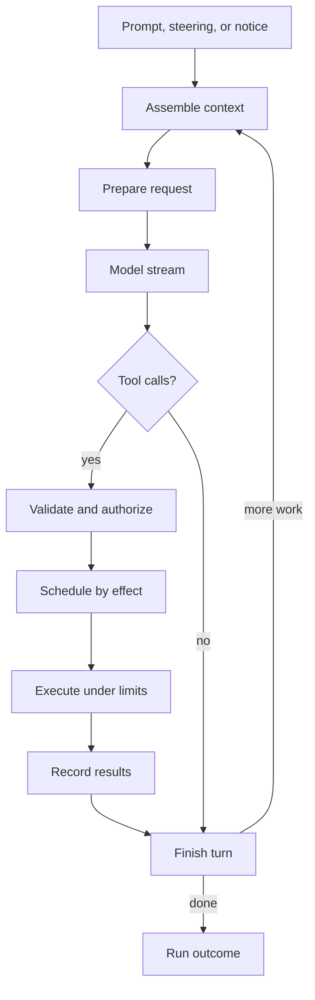

# Core runtime design and the 0.5.0 roadmap

**Status: accepted; in progress.** This page describes the runtime Bake 0.5.0 builds and the order to build it in. A section here is a plan, not current behavior: when a milestone lands, its rule moves into [direction](direction.md) and the owning crate's documentation, and its section and table row leave this page. Landed so far: evaluation ([evaluations](evaluations/README.md)); tool effects ([the loop](../crates/bake-agent/src/agent_loop.rs), [record](evaluations/2026-11-15-tool-effects/README.md)); commands as jobs ([record](evaluations/2026-11-15-commands-as-jobs/README.md), with two [probes](evaluations/README.md#records)); model profiles (no record: without a profile a request is unchanged, which the first-request fixtures prove); the skills listing budget ([record](evaluations/2026-11-15-skills-listing/README.md)); context files found while working, behind `nestedContextFiles` ([record](evaluations/2026-11-15-nested-context-files/README.md)); and the recovery texts ([record](evaluations/2026-11-15-recovery-texts/README.md)). Session storage became the `bake-session` crate, and `agent_session.rs` and `cli/mod.rs` were split by stage. The whole of it was run against the base commit ([record](evaluations/2026-11-15-runtime-against-develop/README.md)). Their behavior is in the user documentation: [the command line](../crates/bake-cli/docs/cli.md), [settings](../crates/bake-cli/docs/settings.md), [skills](../crates/bake-cli/docs/skills.md), and [context](../crates/bake-cli/docs/context.md).

The design was written from a reading of the source at `4ed086385c` and the user documentation. Every model-visible change it proposes is unmeasured until its milestone's paired evaluation runs.

## What stays

- **Pi is the upstream.** The loop keeps Pi's events, hooks, and their order; sessions stay in Pi's format. Each change below is a recorded difference from Pi in the owning module, as today.
- **The model drives; the harness guarantees.** The prompt states outcomes and boundaries. What must hold every time (ordering, confinement, approvals, limits) is enforced in code, and the prompt promises only what the code makes true.
- **Model input is reconstructable.** Everything the model reads reaches it as a recorded message, section patch, or tool declaration change, so a session file reproduces it.
- **Opt-in by measurement.** A model-visible change ships on by default only after a paired evaluation against the base build.

## What changes

What remains of the design:

| Today | In 0.5.0 |
|---|---|
| A plugin can veto and observe, not add a tool | A plugin declares tools with a schema and an effect |

## A turn

The stages exist today; the design names an owner and one contract for each.

- **Assemble context** (`bake-coding-agent`): prompt sections and tool declarations, sent as patches against what the transcript already holds. Its inputs include the model profile, the skills budget, and context files found while working.
- **Prepare request** (`bake-coding-agent`, through the loop's `prepare_request`): context masking, compaction, and limits.
- **Validate and authorize** (`bake-agent` validates; the session's `before_tool_call` authorizes): schema check, then permission preset, approvals, plugin vetoes, and hooks, in the order the model wrote the calls.
- **Schedule by effect** (`bake-agent`): each tool declares what its calls do, and the loop runs a response's calls in segments ([the loop](../crates/bake-agent/src/agent_loop.rs)).
- **Execute under limits** (`bake-agent` and the tools): the run's deadline and model-call allowance (`RunControl`), and each tool's own budget.
- **Finish turn** (`bake-coding-agent`, through `finish_turn`): recovery, retries, notices, steering, and follow-ups.

## Roadmap for 0.5.0

Milestones are in dependency order. Each ends with the workspace checks in [development](development.md), its documentation, a changelog line, and a paired evaluation record read against the [noise floor](evaluations/README.md).

| Milestone | Delivers | Done when |
|---|---|---|
| **M6. Plugin tools** | The next `bake:plugin` capability: a plugin declares tools with a schema and an effect, called through the permission boundary, with a named consumer in `plugins/` and an isolation test | Direction's plugin rule is met. This may ship in 0.5.x without holding 0.5.0 |

**Release gate.** The Linux and Windows checks and the release steps in [the release guide](../distribution/README.md), with every model-visible milestone's record in `docs/evaluations/`.

**Not in 0.5.0.** Everything under "Not planned now" in [direction](direction.md); project-level settings or `mcp.json`, which need a project trust decision Bake does not make; built-in profiles or prompts per model family; and new hook events.

## Open decisions

Each is settled by its milestone's evaluation, or by the owner before it.

1. **Ordered MCP tools by default.** This landed with tool effects: an MCP server's tools run one at a time, also inside a codemode script, unless its entry sets `trustReadOnly`. Its cost for servers whose tools are independent is not measured, since no evaluation task uses an MCP server.
2. **The foreground budget.** 300 seconds is a starting value, not a measured one. In the evaluation and both probes no model let a command reach it unprompted: they give long commands a `timeout` or start them in the background. A budget of 20 seconds raised one model's cost by half on one task without a single handover, so a lower default needs its own record.
3. **The skills budget.** 4,000 estimated tokens keeps a description for about 34 of 43 skills with long paths. Whether a skill listed by name alone is still found is not measured, and writing locations relative to the home directory would free about a third of that listing.
4. **`nestedContextFiles` stays off by default.** Its [record](evaluations/2026-11-15-nested-context-files/README.md) measured no benefit for the three models, which read a directory's `AGENTS.md` themselves. It may help a model that does not; that needs a task such a model fails.
5. **Whether the recovery texts help.** Their record shows no harm. Showing a benefit needs tasks that provoke those errors and runs that keep their event streams.
6. **Plugin tools.** The component interface gains a tools interface in a new version with no new host access. Open: whether tools are declared in the manifest or listed by the component, whether a plugin's own `read` effect is trusted, prefixed or bare names, the consumer plugin, and the `wasm32-wasip2` target the committed components need to be rebuilt, which the development host lacks.
7. **Whether M6 is part of 0.5.0** or follows it.
